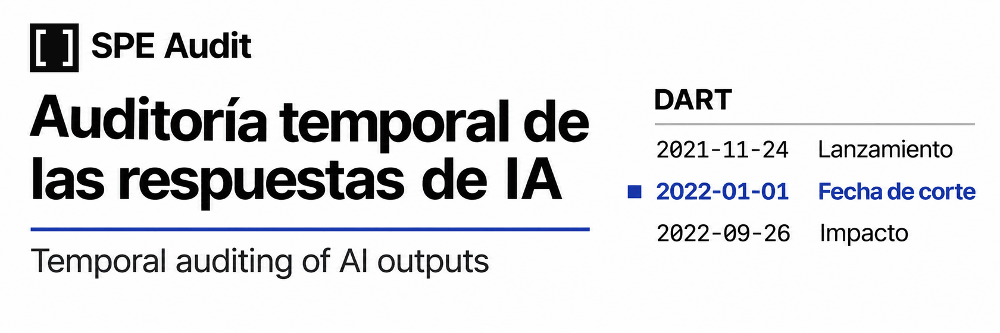

<p align="center"></p>

# SPE Audit

**Rubén Abella · SPE Audit**  
Auditoría temporal de las respuestas de IA · Temporal auditing of AI outputs

El 1 de enero de 2022 ya se podía decir que DART intentaría impactar contra un asteroide. El impacto ocurrió el 26 de septiembre. ¿Qué pasa si una respuesta redactada desde enero lo da por hecho? El artículo reconstruye qué fuentes estaban disponibles y la demo permite cambiar la fecha y comprobar los bytes de la respuesta.

In the new 48-case bilingual challenge, the frozen proposition rule flagged **1 of 18** post-cutoff assertions, raised one false alert and sent **24 of 48** answers to review. The data show which words, dates and source records a reviewer can inspect for each decision.

| Leer · Read | Explorar · Explore | Reproducir · Reproduce |
|---|---|---|
| [Artículo en español](research/temporal-audit/v11/FULL_ES.pdf) · [English paper](research/temporal-audit/v11/FULL_EN.pdf) | [Demo en español](https://www.spetrace.com/es/research/temporal-audit) · [English demo](https://www.spetrace.com/research/temporal-audit) · [Demo sin conexión](research/temporal-audit/v11/explore/offline.zip) | [Datos, código e instrucciones](research/temporal-audit/v11/) |
| [DOI 10.5281/zenodo.24424024](https://doi.org/10.5281/zenodo.24424024) | [Diapositivas](research/temporal-audit/v11/outreach/slides_es.pdf) · [Technical blog](research/temporal-audit/v11/outreach/blog_en.md) | [54 registros históricos](research/temporal-audit/landscape/legacy.csv) · [116 referencias](research/temporal-audit/landscape/bibliography.csv) · [Revisión de fechas](research/temporal-audit/v11/sources/dating_ledger.csv) |

## Stateless Proof Engine

The original Python engine packages a supplied file, text or digest and checks its integrity against the resulting bundle. The optional signature, local clock, declared model identifier and caller-supplied context indicator have different evidentiary roles. The November study adds a separate local request capture and reports the performance of the public year rule. [Research methods and limits](research/temporal-audit/PAPER_EN.md)

## Core Design Philosophy

1. **No Custody** — SPE never stores your files. Processing is transient (in-memory only).
2. **No History** — No logs, no databases of user activity. Privacy by design.
3. **Portable** — Proofs are self-contained. You own the evidence, not the service.
4. **Hermetic Verification** — Proofs can be verified offline, forever, with zero dependencies on SPE infrastructure.

---

## Cryptographic Stack

| Component        | Technology           | Purpose                                     |
| ---------------- | -------------------- | ------------------------------------------- |
| Hashing          | SHA-256              | Cryptographic fingerprint of content        |
| Signing          | Ed25519 (Curve25519) | Digital signature ensuring proof origin     |
| February context digest | SHA-256 over the full serialization | Recompute with the full serialized context |
| Research inclusion proof | Ordered Merkle tree in the [1.1 evidence module](research/temporal-audit/v11/evidence/) | Verify a disclosed item using its inclusion path and the committed root |
| Hash Chain       | SHA-256 Append-Only  | Sequential anti-tampering ledger            |
| Encoding         | Base64               | Portable binary-to-text for signatures      |
| Canonicalization | Deterministic JSON   | Reproducible hashing across implementations |

---

## Quick Start

### Installation

```bash
git clone https://github.com/joinsnipe/SPE_AUDIT.git
cd SPE_AUDIT
pip install -r requirements.txt
```

### Generate a Proof (Python API)

```python
from spe_engine import generate_proof

# Certify a file
result = generate_proof(file_path="document.pdf")
print(f"Proof generated: {result.zip_path}")
print(f"Capsule hash:    {result.capsule_hash}")

# Certify text content (e.g., AI output)
result = generate_proof(content="The answer to life is 42.")
print(f"Proof generated: {result.zip_path}")

# Certify a pre-computed hash (zero-upload mode)
result = generate_proof(hash_hex="a" * 64)
print(f"Proof generated: {result.zip_path}")
```

### Verify a Proof (Python API)

```python
from spe_engine import verify_proof
from pathlib import Path

result = verify_proof(
    bundle_path=Path("SPE_Proof_20260216.zip"),
    original_file=Path("document.pdf"),
)
print(f"Valid: {result.valid}")
print(f"Match: {result.match_status}")  # "MATCH" or "MISMATCH"
```

---

## Verification Semantics

| Result                     | Meaning                                                                  |
| -------------------------- | ------------------------------------------------------------------------ |
| **LEDGER: VALID**          | Stored chain links are internally consistent. An independent checkpoint is needed to detect a rewritten or shortened history |
| **CAPSULE_BINDING: VALID** | The forensic capsule matches the ledger's recorded capsule hash          |
| **SIGNATURE: VALID**       | Ed25519 signature verified against the key in the proof. Establish key ownership separately               |
| **OBJECT: MATCH**          | The file is byte-for-byte identical to the certified version             |
| **OBJECT: MISMATCH**       | The file has been altered since certification                            |

### Important Disclaimers

- **VALID** means mathematical integrity ONLY
- **VALID** does NOT mean truth, authorship, intent, or legal authority
- SPE does not prove who created a file — only that it hasn't been altered
- The verifier is READ-ONLY; it never modifies files

---

## Architecture

| Directory | Contents |
|---|---|
| [spe_engine/](spe_engine/) | Public Python API, hashing, capsule and ledger, signature helpers and temporal year rule |
| [tests/](tests/) | Base engine tests |
| [docs/](docs/) | Protocol and historical design documents |
| [research/temporal-audit/](research/temporal-audit/) | Bilingual monograph, capture adapter, offline demonstration, data and reproduction code |

---

## What's in a Proof Bundle?

A proof bundle (`.zip`) contains:

| File                    | Purpose                                                  |
| ----------------------- | -------------------------------------------------------- |
| `forensic_capsule.json` | The core attestation record (hashes, timestamps, policy) |
| `ledger.sqlite`         | Append-only hash-chain for anti-tampering                |
| `proof_input.json`      | Input manifest, with an optional Ed25519 signature       |

### Forensic Capsule Structure

```json
{
  "t_run": 1708099200,
  "t_target": 2026,
  "gate_policy_id": "strict",
  "model_id": "gpt-4",
  "output_hash": "sha256:7f83b1657ff1fc53b92dc18148a1d65d...",
  "mode": "text",
  "hash_alg": "sha256",
  "artifact_type": "ai-output",
  "context_merkle_root": "a3b8d1b60b3b4b1a9c1a1a2b3c4d5e6f...",
  "proof_input": { ... },
  "proof_input_hash": "9c1a1a2b3c4d5e6f7a8b9c0d1e2f3a4b..."
}
```

---

## Use Cases

### 1. AI Output Certification

Record supplied output text with caller-declared metadata. The study adapter can additionally record the bytes supplied to a local sender.

```python
from spe_engine import generate_proof

# Certify an AI response
result = generate_proof(
    content="Based on the Q3 2025 report, revenue grew 15%.",
    model_id="gpt-4-turbo",
    artifact_type="ai-output",
    policy="strict",
    t_target=2025,
)
```

### 2. Document Integrity

Bind a file digest to the bundle and compare it later with an independently retained copy.

```python
result = generate_proof(
    file_path="contract_v2.pdf",
    artifact_type="legal-document",
)
```

### 3. TVOC Detection (Temporal Violation of Context)

Flag explicit years later than the declared target year when the caller reports no later context. Forecasts, questions and denials can also contain later years.

```python
from spe_engine.tvoc import detect_tvoc_strong

result = detect_tvoc_strong(
    output_text="In 2027, the EU passed new regulations...",
    t_target=2025,
    context_has_post_target=False,
)
# result: {"tvoc": "STRONG", "violating_years": [2027], "t_target": 2025}
```

---

## Public Key

SPE's production Ed25519 public key for signature verification:

```
G7aHboCJsVDCM5exNfewMAyFpbI6ulcy9a5lrIeonyk=
```

This key can be used to verify that a proof was generated by SPE's production infrastructure.

---

## Contributing

We welcome contributions! Please see [CONTRIBUTING.md](CONTRIBUTING.md) for guidelines.

**Key areas for contribution:**

- Additional language implementations (Node.js, Go, Rust verifiers)
- Post-Quantum Cryptography integration (ML-DSA / Dilithium)
- Browser-based verification tools (WebCrypto API)
- Documentation and tutorials

---

## License

The SPE software is licensed under the **Business Source License 1.1 (BSL 1.1)**. Rubén Abella licenses the original article text and original figures under [CC BY 4.0](https://creativecommons.org/licenses/by/4.0/). Trademarks and third-party materials retain their respective rights.

- ✅ **Free for non-commercial use**, research, education, and personal projects
- ✅ **Free for internal evaluation** and testing
- ⚠️ **Commercial use requires a license** — contact contacto@speaudit.com
- 📅 **Change Date**: February 16, 2030 — after which the code becomes Apache 2.0

See [LICENSE](LICENSE) for full terms.

---

## Contact & Support

- **Website**: [speaudit.com](https://www.speaudit.com)
- **Email**: contacto@speaudit.com
- **Commercial Licensing**: contacto@speaudit.com
- **GitHub Issues**: [SPE_AUDIT Issues](https://github.com/joinsnipe/SPE_AUDIT/issues)

---

**SPE** — _Stateless. Portable. Verifiable._

© 2024–2026 Rubén Abella · SPE Audit
