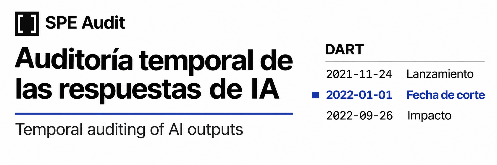

# Auditoría temporal de las respuestas de IA · Temporal auditing of AI outputs

**Rubén Abella · SPE Audit · 21 de noviembre de 2026 · Edición 1.1**

| Acceso | Español | English |
|---|---|---|
| Estudio completo | [Descargar artículo](v11/FULL_ES.pdf) | [Download paper](v11/FULL_EN.pdf) |
| Texto accesible | [Estudio ampliado](v11/SUPPLEMENT_ES.md) · [Estudio base](PAPER_ES.md) | [Extended study](v11/SUPPLEMENT_EN.md) · [Base paper](PAPER_EN.md) |
| Demostración | [Abrir la demo en español](https://www.spetrace.com/es/research/temporal-audit) · [Descargar demo](v11/explore/offline.zip) | [Interactive research site](https://www.spetrace.com/research/temporal-audit) · [Download demo](v11/explore/offline.zip) |
| Presentación | [Diapositivas](v11/outreach/slides_es.pdf) · [Artículo técnico](v11/outreach/blog_es.md) | [Slides](v11/outreach/slides_en.pdf) · [Technical article](v11/outreach/blog_en.md) |
| Reproducción | [Código y datos](v11/) · [Decisiones caso a caso](v11/results/decisions.csv) | [Code and data](v11/) · [Updated dating register](v11/sources/dating_ledger.csv) |

En el desafío nuevo de 48 respuestas en español e inglés, la regla de proposiciones detectó **1/18** afirmaciones posteriores al corte, produjo **una falsa alarma** y remitió **24/48** casos a revisión. El registro bibliográfico conserva los identificadores de las 116 referencias y detalla la búsqueda de las 58 que necesitaban fecharse. El estudio completo incorpora ambos bloques de la investigación.

**Citation.** Abella, Rubén (2026). *Temporal auditing of AI outputs: request-level evidence, prior art and the limits of automated detection*. Version 1.1. [DOI 10.5281/zenodo.24424024](https://doi.org/10.5281/zenodo.24424024).

Original text and original figures © Rubén Abella, licensed under [CC BY 4.0](https://creativecommons.org/licenses/by/4.0/). Trademarks and third-party materials retain their respective rights. [Software licence BSL 1.1](../../LICENSE).

## Estudio base · Original study

**Rubén Abella · SPE Audit · 21 noviembre / November 2026 · Edición 1.0**

| | Español | English |
|---|---|---|
| **Artículo completo** | [Leer PDF](PAPER_ES.pdf) · [Leer texto accesible](PAPER_ES.md) | [Read PDF](PAPER_EN.pdf) · [Read accessible text](PAPER_EN.md) |
| **Antecedentes** | [54 fichas históricas](landscape/legacy.csv) · [116 referencias](landscape/bibliography.csv) · [Notas en castellano](landscape/bibliography_notes_es.csv) | [Historical register](landscape/legacy.csv) · [Reference ledger](landscape/bibliography.csv) · [Coverage and provenance](landscape/coverage.md) |
| **Datos** | [Decisiones caso a caso](study/results/predictions.csv) · [Resultados](study/results/summary.json) | [Case decisions](study/results/predictions.csv) · [Results](study/results/summary.json) |
| **Probar** | [Descargar demo y kit sin conexión](https://github.com/joinsnipe/SPE_AUDIT/raw/refs/heads/main/research/temporal-audit/replication.zip) | [Download the offline demo and kit](https://github.com/joinsnipe/SPE_AUDIT/raw/refs/heads/main/research/temporal-audit/replication.zip) |

## Para quien llega por primera vez

La NASA anunció en 2021 que DART **intentaría** chocar con un asteroide. El choque **ocurrió** el 26 de septiembre de 2022. Desde un corte en enero de 2022, la primera frase describe un plan documentado. La segunda ya cuenta el desenlace. Una regla que solo busca años puede pasar por alto esa diferencia. El estudio enseña las fuentes admisibles, la frase exacta y la decisión de cada regla. [Anuncio](https://www.nasa.gov/news-release/nasa-spacex-launch-dart-first-test-mission-to-defend-planet-earth/) · [Resultado](https://www.nasa.gov/solar-system/darts-final-images-prior-to-impact/)

La regla que usa los sucesos fechados detectó **24 de 32 positivos** en 96 casos de desarrollo. En 16 casos redactados por separado detectó **0 de 8** positivos y mandó **14 de 16** a revisión. El detector anual de la base pública detectó **4 de 32** y **1 de 8** respectivamente. Las frases evaluadas están en inglés. La demo ofrece una traducción editorial y mantiene visible el texto al que se aplicó la regla.

### Abrir la demo o repetir el estudio

1. Descargue el ZIP enlazado arriba y extráigalo en una carpeta.
2. Abra `demo.html` en un navegador moderno. Elija idioma y caso y pulse el botón de comprobación de huellas. La demo incluye ocho ejemplos. El CSV incluye las 112 clasificaciones.
3. Con Python 3.10 o posterior, abra esa carpeta en un terminal y ejecute `python3 verify.py` (Windows con el lanzador de Python, `py -3 verify.py`). La verificación completa usa la biblioteca estándar y funciona sin Internet. El ZIP incluye el estudio completo en PDF y Markdown en ambos idiomas.

## For a first-time reader

In 2021 NASA announced that DART **would attempt** to hit an asteroid. The impact **occurred** on 26 September 2022. As of January 2022 the plan was on record. Reporting the impact as accomplished would have crossed the cutoff. The study lets a reader inspect eligible sources, exact wording, each decision and the byte-level capture.

The event-aware rule detected **24/32** positives in the constructed cases and **0/8** in the separately authored challenge. It referred **14/16** challenge cases for review. The public year rule detected **4/32** and **1/8**. The captures identify the input and output of a local callback. Provider-side inference and the truth of model assertions require other evidence.

Download the ZIP above, extract it and open `demo.html` to explore eight cases in Spanish or English. Run `python3 verify.py` (or `py -3 verify.py` on Windows with the Python launcher) from the extracted folder for the full offline check. The ZIP includes both full PDF and Markdown editions. The [reproduction report](study/REVIEW.md) records the platform used.

## Qué contiene la publicación · Release contents

| Material | Scope |
|---|---|
| [Manuscrito ES](PAPER_ES.md) · [EN manuscript](PAPER_EN.md) | The full prior-art registers appear within each edition, alongside a 13-feature comparison, experiment, limits and European AI Act discussion. |
| [Fuentes de las misiones · Mission sources](study/data/events.json) | Four historical events, eight planning/outcome source cards, agency links and dated summaries. |
| [Experimento · Study](study/reproduce.py) | 96 constructed comparisons, 16 wording-challenge cases and 12 deterministic retrieval interventions. |
| [Capturas · Captures](study/results/capsules.jsonl) | 124 inspectable records. Published SHA-256 of the JSONL is `174ca466891bbd35e8c5b208b612d74dddf4984b9e7a31537bf7e02d41447e20`. |
| [Piloto histórico · Archived pilot](field/README.md) | A separate application log comprises 25 attempts, 22 returned texts and three capacity errors. The public release contains a minimised recount with source notes. |
| [Licencia · Licence](https://github.com/joinsnipe/SPE_AUDIT/blob/main/LICENSE) | The repository retains its Business Source License 1.1 terms. A copy accompanies the vendored baseline and offline package. |

**Cita sugerida · Suggested citation.** Rubén Abella · SPE Audit (2026). *Temporal auditing of AI outputs: request-level evidence, prior art and the limits of automated detection*. Public research edition 1.0, 21 November 2026. Spanish and English. Cite the Git commit of the release you consulted.

Las correcciones públicas pueden identificar un caso, una fuente M, N o B, y la prueba que cambia su interpretación. Public corrections can identify a case or source and the evidence for the proposed change. [Incidencias · Issues](https://github.com/joinsnipe/SPE_AUDIT/issues)
