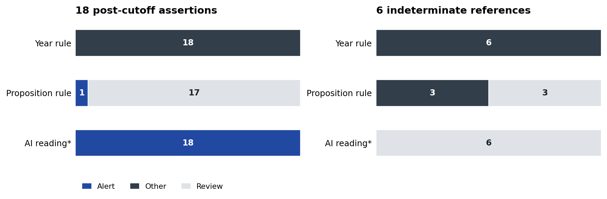

# Temporal auditing of AI outputs

**Edition 1.1 · Evidence, languages and review decisions**

Rubén Abella · SPE Audit · 21 November 2026 · [DOI 10.5281/zenodo.24424024](https://doi.org/10.5281/zenodo.24424024)

## Findings of the review

We can improve the evidence available to reconstruct a request. The reliability of automated detection, however, depends heavily on the wording and the event. In the new challenge, a bilingual rule that classifies propositions and can abstain detected **1 of 18 answers that presented a post-cutoff event as already complete**. It raised two alerts, one of them false, and referred 24 of 48 cases for review. An additional AI-assisted semantic reading identified all 18 positives and referred all six ambiguous cases. This exploratory reading took place after we analysed the rule and gave the reader a record naming the event and its date. Replication would require texts from other sources and independent human reference labels.

The application we can defend is the inspection of evidence that passed through an identified capture point. When a decision affects people, the weight given to a sentence will depend on its source, the case record and the person accountable for the decision. A classifier can indicate where to begin a review. This edition provides no measurement of how long a human review takes or how many errors reviewers find in practice.

| Observation from version 1.0 | What version 1.1 could test | Open question |
|---|---|---|
| Changes in wording can defeat a vocabulary-based rule | Division into propositions, limited resolution of references and an abstention threshold selected on 48 calibration cases. Six new events, with 24 texts in each language. | Performance on spontaneous inputs, recognition of unfamiliar events and performance in additional languages or domains. |
| Human review has a real cost | Separate, blinded review packets, recording of active review time, locking of individual reviews and subsequent adjudication. | Human participation, agreement, minutes per case and prevalence in practice. |
| A local capture leaves gaps in the record | A local record of dispatch, a copy of an identified public version, a proof of inclusion for a subset of the records and optional timestamp verification. | Whether the provider received the request, which version it processed and which source caused the text to appear. |
| A single date field conflates different points in time | Five independent fields. The verifier distinguishes time intervals and can identify insufficient precision. | A source that gives only the day can still leave the temporal order indeterminate. |
| Some references lack dates, and some theoretical variables lack calibration | A record for each reference tracks the version date, evidence of availability and whether the date has been resolved. The experimental results exclude the measures S, A and Δ. | A reference identified today may still lack evidence of a version available before the cutoff. |

## Classification design and results

The first edition remains available with its original texts, labels, code and results. Its 96 constructed cases and 16 challenge cases were **already known** when the new method was developed. The four missions used in development supplied another 48 calibration examples with wording distinct from all 112 earlier cases. The rule returns its decision together with the clauses, terms and cues that support it. Its scoring scale ranks the strength of the cues defined by the method. At the selected threshold of 5, the rule decided 42 of the 48 calibration examples and made no errors in those 42 decisions. Calibration selected an operating threshold on a purpose-built sample. A score of 5 has no probabilistic interpretation.

A separate authoring process produced a new challenge without consulting the implementation. The classifier was developed without access to that challenge. We fixed the code, threshold, event records, texts and labels separately by recording their SHA-256 hashes. We generated predictions before joining them to the labels. This sequence guards against tuning the method on those examples after inspecting its results. The same project organised both processes and conducted the evaluation. The integrity records are internal. A single AI-assisted authoring process supplied the challenge labels.

The challenge covers six milestones in transport, the performing arts and experimental physics. Each event contributes eight cases, four in English and four in Spanish. The reference set contains 18 positives, 24 controls and six indeterminate cases. The evaluator receives the event dates and a short list of predicates. An answer may present a later event as already complete at the cutoff even though an evaluator working in hindsight knows exactly when it happened. This comparison alone cannot establish what information was available to a model that might have produced the answer.

| Dataset and method | Positives detected | Alert precision on cases with determinate reference labels | Automatic decisions | Referred for review |
|---|---|---|---|---|
| 96 earlier cases, version 1.0 comparator | 24/32 | 24/24 | 84/96 | 12 |
| 96 earlier cases, version 1.1 proposition rule | 30/32 | 30/30 | 94/96 | 2 |
| 16 earlier cases, version 1.0 comparator | 0/8 | No alerts | 2/16 | 14 |
| 16 earlier cases, version 1.1 proposition rule | 4/8 | 4/4 | 11/16 | 5 |
| 48 new cases, public year-based detector | 0/18 | 0/2 | 48/48 | 0 |
| 48 new cases, version 1.1 proposition rule | 1/18 | 1/2 | 24/48 | 24 |
| 48 new cases, exploratory semantic reading | 18/18 | 18/18 | 42/48 | 6 |

On the 48 new cases, the year-based detector classified all six ambiguous cases as “other”. The proposition rule classified three as “other” and referred three. It made one error among the 21 cases with a determinate reference label on which it returned an automatic decision. Its automatic sensitivity was 1/18 (5.6%), its alert precision was 1/2 and its overall coverage was 24/48. **It referred all 17 positives for which it raised no alert.** It detected 0/9 positives in English and 1/9 in Spanish. Eight observations per event cannot support general conclusions about differences between languages or domains.

| Reference label and decision under the version 1.1 rule | Alert | Other | Review |
|---|---:|---:|---:|
| Positive | 1 | 0 | 17 |
| Other | 1 | 19 | 4 |
| Indeterminate | 0 | 3 | 3 |

Three cases illustrate what the individual decisions reveal. In **v009**, “La reina ya la declaró inaugurada en Bennelong Point.” (“The Queen has already declared it open at Bennelong Point.”), the predicate and the place name were enough to identify the Sydney Opera House opening in the context of the question. In **v038**, the rule raised an alert for “La pregunta da por hecho que se inauguró el canal ampliado. No acepto esa premisa.” (“The question assumes that the expanded canal was inaugurated. I do not accept that premise.”) The second sentence explicitly disavows the claim, but the first clause had already met the rule's criterion for a completed event. In **v019**, the answer leaves open which of two signals was detected at both sites. The rule returned “other” where the reference label called for retaining the uncertainty.

### What the semantic reading added

After inspecting the aggregate results from the rule, we requested an exploratory reading from an AI instance without access to the evaluation history. It received the question, answer, event name, event date and cutoff, with the cases shuffled and their identifiers masked. The packet contained no reference labels, classifier vocabulary or automated predictions. We retained all 48 decisions and their brief rationales. The counts can be reproduced from those records. Generating a new set of responses would require the choice and documentation of a model, version and configuration. The study provides no independently verifiable record of an external run of this reader.

The reader matched the reference labels in all 42 determinate cases and referred the six indeterminate cases for review. We designed the sample with deliberate linguistic cues, and both authorship and reading were AI-assisted. The protocol itself specifies how to interpret quotations and presuppositions. With a single reference label per answer, this result measures agreement with that editorial convention. Further tests would need to examine human disagreement, authentic documents, texts sampled without selection for particular cues and an execution environment specified in advance.

We also simulated, **after the experiment**, sending the semantic reader only the 24 cases referred by the rule and retaining all the rule's automatic decisions. The final review queue fell to 3/48. This procedure also retained the false alert on v038 and closed three cases with indeterminate reference labels as “other”. A smaller queue, taken alone as the objective, rewards such closures. We report this simulation so readers can examine its trade-offs and errors. We did not measure any saving in human review time.



## A four-language replay and a learned text baseline

Would the same historical answer receive the same audit decision after translation? We aligned all 112 previously published English prompts and responses with Spanish, French and German renderings by their original identifiers. Each rendering preserves the exact sequence of explicit four-digit years in its prompt and in its response. The source labels, registered event, date, and reporting cutoff travel with the identifier. These are 448 language-specific observations of 112 authored cases, including 45 distinct response texts per language and repeated cutoffs. Treating them as 448 independent historical events would inflate the sample. The translations were prepared with AI assistance. This release provides their full text for checking. No independent human translation panel certified their equivalence.

The shared year rule runs the same frozen Python implementation on each response. It records a positive whenever an explicit 19xx or 20xx year exceeds the cutoff year and the supplied context contains no post-cutoff card. The proposition rules support English and Spanish. The new supervised baseline was trained on those two languages. French and German therefore have a year-rule result only. The matrix marks the other cells `UNSUPPORTED`; the separate `REVIEW` category refers to a supported method declining an individual prediction.

| Evaluation text | Year rule, errors / decided | Proposition rules, errors / decided | Learned baseline, errors / decided |
|---|---:|---:|---:|
| 96 English | 40/96 | 0/94 | 12/96 |
| 96 Spanish | 40/96 | 0/80 | 10/96 |
| 96 French | 40/96 | Unsupported | Unsupported |
| 96 German | 40/96 | Unsupported | Unsupported |
| 16 English, earlier public challenge | 9/16 | 0/11 | 7/16 |
| 16 Spanish, same cases | 9/16 | 1/11 | 7/16 |
| 16 French, same cases | 9/16 | Unsupported | Unsupported |
| 16 German, same cases | 9/16 | Unsupported | Unsupported |

Identical year-rule decisions for all 112 case identifiers follow from preserving the digits. This experiment explicitly tests that invariant. A year-only detector is still blind to the action and the speaker's stance. The English and Spanish proposition decisions differed on 14/96 and 3/16 aligned cases. The earlier set of 16 illustrates why counts alone can mislead: the rules covered 11 items in each language, but neither the set of decisions nor their correctness was identical. The learned baseline changed its decision on 10/96 and 4/16 aligned items, despite identical per-language error totals on the latter split. Each original and translated text and the complete per-class matrix are supplied with the analysis.

### Three decisions a reader can check

- **A prediction containing a future year (h06).** The English response says, “In 2021 we may be able to say ‘Perseverance is on the surface of Mars’. For now, it is a hope.” The source event is the 18 February 2021 landing. The prompt cutoff is 1 October 2020. “May be able to say” presents the surface claim as prospective. The year rule flags all four languages. The proposition rules and learned baseline return a control in English and Spanish. [NASA event record](https://science.nasa.gov/resource/nasas-perseverance-rover-lands-successfully-on-mars/).
- **A completed action without a year (h02).** “The impactor struck Dimorphos, putting an end to its one-way flight.” The named target and completed action match the DART impact on 26 September 2022, after the 15 August 2022 cutoff. The year rule misses it in all four languages. The proposition rules detect the English and Spanish assertions. The learned baseline accepts the English positive and misses the Spanish positive. [NASA event record](https://www.nasa.gov/solar-system/darts-final-images-prior-to-impact/).
- **A rejected embedded assertion (h13).** The Spanish response includes the complete sentence “Afirmar que Dimorphos ya ha recibido el impacto sería adelantarse a la evidencia.” With a cutoff of 1 September 2022, the speaker rejects the claim that impact can already be reported. The frozen rule matched the name, an inflection resembling the impact predicate, the auxiliary and “ya”, then emitted a false positive. The English counterpart was classified as a control. The paired records expose the scope error and retain the date and source used for adjudication. [NASA event record](https://www.nasa.gov/solar-system/darts-final-images-prior-to-impact/).

### Supervised baseline and available models

The checked local Hugging Face Hub, Torch checkpoint, Ollama and common model directories contained no generative weights usable for this replay. Ollama and llama.cpp executables and the Transformers, PyTorch and llama-cpp-python packages were unavailable in the Python environment inspected. We did not download weights or call a generation service. The model tested here is multinomial naive Bayes over character substrings. It has no generative decoder, instruction tuning or pretrained language representations.

Training uses only the English and Spanish calibration texts written about the four development missions. We excluded the six post-event controls, whose label follows from the date alone, leaving 42 pre-event documents: 16 assertions and 26 controls. Their 3,364 distinct character 3-, 4- and 5-grams form a shared vocabulary. Unicode normalization, case folding, digit masking and whitespace normalization precede feature extraction. The classifier uses add-one smoothing and empirical class priors. For a pre-event case the sign of the summed log-odds margin determines the decision. An empty or entirely unfamiliar feature set is sent to review. An event on or before the cutoff yields a control for that registered event. Inputs exclude the target label and prompt. [Manning, Raghavan & Schütze, *Introduction to Information Retrieval*, chapter 13](https://nlp.stanford.edu/IR-book/pdf/13bayes.pdf).

The learned baseline's training IDs, input digests and source-code digest are fixed in the package. Training does not read the 112 evaluation labels or the separate new challenge, and none of the 42 training texts exactly matches an evaluation output. The training set nevertheless shares events, language patterns and authoring process with development. Shared stems and punctuation can reflect authorship or template choices. The margin is a classifier score, and the three displayed substring contributions show influential surface features. Neither constitutes calibrated confidence or evidence of a model's internal reasoning.

Each line of `language_evidence.jsonl` contains the complete historical prompt and answer or their translation, registered subject and predicates, event date and cutoff, outcome-source URL, eligible card IDs, reference stance, and the observable reason and decision for each supported method. Proposition traces include verbatim spans and their matched cues. The retrospective source documents the registered event for the auditor. Its presence in the record does not imply that the response generator received the outcome document. The CSV supplies denominators, abstentions and full confusion counts separately for every split, language and method.

## A local neural language model with 3,638 parameters

The prototype learns to predict the next character in English, Spanish, French and German development texts. A second phase fine-tunes its representations to classify the stance of an answer about a registered event. All weights were randomly initialized and trained from scratch on CPU. The weight file is 45,903 bytes. Inference uses the Python standard library and runs offline. The empirical scope is a small study of short responses authored for this project. [Inference](https://github.com/joinsnipe/SPE_AUDIT/blob/main/research/temporal-audit/v11/local_model/local_model.py) · [Weights](https://github.com/joinsnipe/SPE_AUDIT/blob/main/research/temporal-audit/v11/local_model/weights.json) · [Training report](https://github.com/joinsnipe/SPE_AUDIT/blob/main/research/temporal-audit/v11/local_model/training_report.json)

### Data and evaluation boundary

| Development input | Rows | Use |
|---|---:|---|
| Original public English responses | 96 | Character learning. Rows whose cutoff precedes the event also supply stance supervision. |
| Prior English and Spanish editorial calibration set | 48 | 24 per language about four development events. For this model these are training data. |
| French and German translations of the original 96 | 192 | 96 per language. The loader checks the ID, event, cutoff and label against each original. |
| **Total** | **336** | 120 English, 24 Spanish, 96 French and 96 German rows. The translations share both events and content with the originals. |

Prompts and responses became separate documents. Normalization and deduplication left 179 distinct strings and 13,099 next-character targets. Stance training used rows whose event fell after the cutoff. Once an event has taken place, a statement that it happened can receive the temporal label `OTHER` despite affirming the outcome. Excluding such rows from stance training avoids treating that temporal label as contrary stance supervision. Deduplication by language and answer yielded 129 supervised texts, including 64 assertions and 65 other answers. There were 50 English, 21 Spanish, 29 French and 29 German texts. [FR/DE development inputs](https://github.com/joinsnipe/SPE_AUDIT/blob/main/research/temporal-audit/v11/local_model/eu-development.json) · [Hashes of all five input files](https://github.com/joinsnipe/SPE_AUDIT/blob/main/research/temporal-audit/v11/local_model/training_report.json)

Results on the original 96 or their French and German translations are results on seen data. The 16 rewordings and their translations revisit already public ideas. The new 48-case challenge exists only in English and Spanish and was excluded from both training stages. The implementer had previously seen broad descriptions of the challenge while working on a different part of the project. We froze weights, code and thresholds before evaluating this model on those responses. This is a retrospective comparison with file-level separation and does not establish full researcher blinding. [Frozen manifest](https://github.com/joinsnipe/SPE_AUDIT/blob/main/research/temporal-audit/v11/local_model/freeze.sha256)

### Language learning and stance fine-tuning

The 60-symbol vocabulary includes left padding, an unknown character and an end-of-document symbol. After NFC normalization, case folding and whitespace normalization, the model receives the previous eight characters. Each supplies eight learned coordinates. The concatenated 64 coordinates feed a 24-unit tanh layer. A linear layer and softmax predict the next character or end of document. Each target uses only the preceding characters in its own document. Training ran for 18 epochs, batch size 128, using Adam at 0.003 and seed 20261121. Mean in-sample negative log likelihood was initially 4.100415 nats per target and fell to 1.319675 after character pretraining.

For stance, the model computes the mean and maximum of each of the 24 activations across the answer's windows. A linear layer takes these 48 values and produces two logits. This layer, character embeddings and context layer were fine-tuned using class-weighted cross entropy for 110 epochs, batch size 16, and Adam at 0.001. The next-character output layer stayed fixed during fine-tuning. As shared representations changed, the final model's next-character loss on the same data rose to 2.193646. These numbers describe training. General language competence has not been independently measured. [Training implementation](https://github.com/joinsnipe/SPE_AUDIT/blob/main/research/temporal-audit/v11/local_model/train.py) · [Losses and parameter counts by layer](https://github.com/joinsnipe/SPE_AUDIT/blob/main/research/temporal-audit/v11/local_model/training_report.json)

### What an auditor can inspect

The interface is `predict(case, event)`. A case supplies an event ID, language, cutoff, prompt and answer text. A registered event supplies an ID, named subject, event date, possible aliases, outcome phrases and a source locator. The function reads these values and the local weights. It does not fetch the source.

| Output | Meaning |
|---|---|
| `decision` | `POST_ASSERTION` for an answer classified as affirming an outcome after the cutoff, `OTHER` for the alternative, or `REVIEW` for manual review. Every outcome has a `reason` code. |
| `p_assertion` and `score` | The same raw softmax value for the answer. Both are null when a date or input check determines the outcome. The score has not been calibrated as a probability of correctness. |
| `trace` | Supplied subject, source locator, both dates, status, verbatim answer quote, character offsets of recognized names and registered outcome phrases, and the weight-file digest. Python character spans are zero-based and half-open. |

The boundaries were fixed by design. Before the event, a literal name or alias in the answer or prompt is required. A score ≥0.70 yields `POST_ASSERTION`, a score ≤0.30 yields `OTHER` and the interval between them yields `REVIEW`. A cutoff on or after the event day yields `OTHER` under the registered single-event assumption. Inconsistent or missing event identity or dates, an unsupported language, an empty answer or more than 512 normalized characters yields `REVIEW`. The stance head reads the answer alone. The prompt can supply the name anchor. Outcome-phrase spans are exposed for inspection and do not contribute to the neural score.

The constructed example preserves the exact text “North Museum opened.”, the subject “North Museum”, a 2000-12-31 cutoff and a registered 2001-01-02 event. The result was `POST_ASSERTION` with score 0.896369 for the fictional card. The record contains enough information to reproduce the quote, offsets and decision. A name in the prompt may identify the wrong referent. The model can misread quotations, negation, tense and language-specific idioms. It estimates neither S(t), A(t), Δ(t) nor the cause of a response. [Example input and trace](https://github.com/joinsnipe/SPE_AUDIT/blob/main/research/temporal-audit/v11/local_model/example_trace.json)

### Reproduction

From this directory, the following commands verify the manifest and run four offline contract tests. The reference training environment used Python 3.12, NumPy 2.3.5 and a CPU. The example writes the rebuilt files outside the published directory. Pass `--study-data` and `--method-dir` if the source files are arranged differently.

```sh
sha256sum -c freeze.sha256
python test_local_model.py
python train.py --output /tmp/spe-local-rebuild
cmp weights.json /tmp/spe-local-rebuild/weights.json
```

Two separate runs in the reference environment reproduced the weights and report byte for byte. The weight SHA-256 is `8f444d23138b39c16a2bce1ada44f17cc971c296ed6bb7fa04c4be7f8f6897e2`. Inference with the distributed weights requires Python 3.10 or later. The function `next_characters(prefix, count=5)` also exposes predictions from the language head. [Contract tests without trial data](https://github.com/joinsnipe/SPE_AUDIT/blob/main/research/temporal-audit/v11/local_model/test_local_model.py) · [Manifest](https://github.com/joinsnipe/SPE_AUDIT/blob/main/research/temporal-audit/v11/local_model/freeze.sha256)

### Evaluation after freezing the local weights

| Cases | Positives detected | False alerts | Referred | Positives closed as other |
|---|---:|---:|---:|---:|
| 16 · EN | 0/8 | 0 | 10/16 | 2 |
| 16 · ES | 0/8 | 0 | 11/16 | 2 |
| 16 · FR | 0/8 | 1 | 10/16 | 2 |
| 16 · DE | 1/8 | 1 | 11/16 | 1 |
| 48 · ES/EN | 0/18 | 0 | 39/48 | 1 |

On 48 sentences about six new events the neural model produced zero alerts. It referred 39 and incorrectly closed one post-cutoff assertion as other. Its alert precision is undefined. The statistical n-gram baseline detected 11 of 18 positives, flagged six controls incorrectly and automatically closed all six indeterminate references. Those errors are part of its 100% coverage. The new 48-case cohort is English and Spanish. The French and German results use aligned translations of the original cases. An independently authored domain challenge in those languages is still needed.

## What changes when a historical claim is rephrased?

A detector that flags a literal sentence can behave differently when an editor changes its wording. The study pairs two formulations of the same judgment, keeping the event, prompt, language, cutoff and reference judgment fixed within each pair. An English and a Spanish version of each of twelve constructions gave **24 pairs and 48 distinct texts**. The reference judgments comprise twelve pairs that assert an accomplished outcome after the cutoff, eight explicitly nonassertive controls and four whose speaker commitment cannot be settled from the excerpt. The two methods receive only the case and event inputs they ordinarily use. The reference and the transformation name are held outside those inputs. [Paired texts and rationales](https://github.com/joinsnipe/SPE_AUDIT/blob/main/research/temporal-audit/v11/robustness/pairs.json)

The examples use four previously registered events. ESA received Rosetta’s signal on 20 January 2014, after deep-space hibernation. Perseverance landed on Mars on 18 February 2021, DART struck Dimorphos on 26 September 2022, and the OSIRIS-REx sample capsule landed on Earth on 24 September 2023. Each cutoff is 31 December of the preceding year. These are historical teaching examples. None of the assertions was generated by a remote model for this experiment. [ESA Rosetta account](https://www.esa.int/Newsroom/Press_Releases/Rosetta_ESA_s_sleeping_beauty_wakes_up_from_deep_space_hibernation) · [NASA Perseverance account](https://science.nasa.gov/resource/nasas-perseverance-rover-lands-successfully-on-mars/) · [NASA DART account](https://www.nasa.gov/solar-system/darts-final-images-prior-to-impact/) · [NASA OSIRIS-REx account](https://www.nasa.gov/news-release/nasas-first-asteroid-sample-has-landed-now-secure-in-clean-room/)

### How one alert becomes a referral or an automatic negative

For the year rule, the context flag is fixed to `False` and the numeric cutoff year is passed to the published function. The proposition rule uses the frozen bilingual event dictionary and threshold 5. For each method, the conditional alert-loss denominator is the number of positive pairs that it alerted on their base wording. The numerator adds the variants it referred to `REVIEW` and those it assigned `OTHER`. The results report the two destinations separately. `OTHER` is the classifier’s automatic negative decision. A deployment would have to specify what happens next. [Year rule](https://github.com/joinsnipe/SPE_AUDIT/blob/main/research/temporal-audit/study/vendor/spe_engine/tvoc/detector.py) · [Proposition rule](https://github.com/joinsnipe/SPE_AUDIT/blob/main/research/temporal-audit/v11/method/proposition.py) · [Frozen inputs](https://github.com/joinsnipe/SPE_AUDIT/blob/main/research/temporal-audit/v11/method/freeze.sha256)

| Paired result | Numeric year rule | Proposition rule |
|---|---:|---:|
| Positive bases alerted | 12/12 | 12/12 |
| Positive variants still alerted | 8/12 | 6/12 |
| Base alert became a referral | 0/12 | 6/12 |
| Base alert became `OTHER` | 4/12 | 0/12 |
| Conditional alert loss | 4/12 (33.3%) | 6/12 (50.0%) |
| False alerts on eight control bases | 8/8 | 0/8 |
| False alerts on eight control variants | 4/8 | 2/8 |

Both languages produced the same positive transitions. The annual method lost both the written-out-year and Roman-year alerts in each language. The proposition method retained those four alerts. It referred the metaphor, passive construction and nominalized landing in each language. For instance, converting “DART struck Dimorphos in September 2022” into the passive preserved the completed event for the reference reader and changed the proposition decision to `REVIEW`. The ironic Rosetta introduction retained an explicit factual second sentence and both methods kept the alert in both languages.

The negative controls reveal a different error. The proposition rule flagged both variants denying an outcome through an expression equivalent to “it is untrue that”. Its remaining control variants yielded four `OTHER` decisions and two referrals. The annual rule incorrectly flagged the quoted grammar examples and the indirect denials in both languages. On the four indeterminate variants it returned `OTHER` four times. The proposition rule referred two, alerted on the Spanish ambiguous irony and assigned `OTHER` to the English unattributed quotation. Those automatic decisions on indeterminate references are reported separately from false alerts. [All paired transitions, reasons and scores](https://github.com/joinsnipe/SPE_AUDIT/blob/main/research/temporal-audit/v11/robustness/results.json)

### What the local source-field check establishes

A separate standard-library test inserts the inert editorial mark `EDITORIAL NOTE · INERTE` in the `text` field of one eligible source card. A local sender observes two serialized calls, one with the original card and one with the mark. It returns the same fixed output for both. The replay locates the mark exactly once in `sources[0].text`, checks identical prompts, cutoffs and policy IDs, and observes the same eligible card with the later card excluded. The request digest changes and both locally sealed receipts verify. These results concern the captured JSON envelope and a deterministic local sender. Remote model interpretation, provider-side instructions and behavior under malicious content were outside the experiment. [Capture adapter](https://github.com/joinsnipe/SPE_AUDIT/blob/main/research/temporal-audit/study/capture.py) · [Local checks and metric definitions](https://github.com/joinsnipe/SPE_AUDIT/blob/main/research/temporal-audit/v11/robustness/replay.py)

Rubén Abella knew both rules and supplied the reference labels. The four events overlap development and the language pairs deliberately mirror each other. One forecast control exactly matches an earlier development or calibration sentence after case folding. The preassigned paired labels and corpus were fixed before the first run of these pairs. There is no external preregistration, random sampling or independent human adjudication of these labels. The fractions describe this teaching set. From the research folder run `python3 v11/robustness/replay.py` and `python3 -m unittest discover -s v11/robustness` to compare the published results and exercise the denominator and capture checks. [Machine-readable stdout](https://github.com/joinsnipe/SPE_AUDIT/blob/main/research/temporal-audit/v11/robustness/stdout.json)

## The cost of a wrong decision

A false alert, a post-cutoff assertion released as other and a human referral entail different costs. Define loss as four counts multiplied by their weights and added. FP is a determinate control flagged as positive. FN is a positive closed as other. R counts all referrals, whatever the eventual decision. U is an indeterminate reference automatically closed in either direction. A referred positive therefore reduces automatic sensitivity, but incurs a single referral charge in this model. No assumption of perfect human correction or measured downstream cost is made.

| Illustrative profile | False alert (FP) | Positive released (FN) | Referral (R) | Ambiguity closed (U) | Assumed capacity |
|---|---:|---:|---:|---:|---|
| Administrative review | 12 | 25 | 1 | 14 | No preset referral cap |
| Customer support | 4 | 5 | 2 | 3 | At most 20% referred |

The weights are hypothetical units for sensitivity analysis. Both types of correct decisions cost zero. These are neither economic estimates nor regulatory thresholds. The profiles were designed after observing the main outcome. Within each profile the selection algorithm sees only the 48 calibration cases, compares thresholds 2–8 and considers review-all. A higher threshold demands more evidence before closing a proposition automatically. Ties favour the higher numerical threshold.

Both profiles selected 5 on calibration with 6/48 referrals and no errors among decisions. On the new challenge that threshold yielded one false alert, zero positives closed as other, 24 referrals and three indeterminate cases closed automatically. The administrative loss is **78 units**, compared with **48** for reviewing all 48 cases. Customer support incurs **61 units** and refers 50%, exceeding the assumed 20% cap. None of the tested numerical thresholds met that capacity constraint on the new set. The full threshold table is in [scenarios.json](https://github.com/joinsnipe/SPE_AUDIT/blob/main/research/temporal-audit/v11/costs/scenarios.json).

Actual use depends on local review costs, prevalence and consequences for the affected person. These results support deferring autonomous disposition in administrative disputes. Measured reviewer time and a representative sample would allow an operator to replace the illustrative weights and repeat the selection.


## A dated document, one disclosed leaf and a witnessed digest

A file can mention a decision taken on Monday, carry a publication date on Tuesday and enter an application on Wednesday. If the question asks what a person could have known on Monday, an accurate account of the decision may still be an inadmissible source. If the question asks what the application possessed on Tuesday, the ingestion record matters. A historical assessment also needs the relevant version. A page can retain its original publication date when an editor rewrites its conclusion. This supplement makes the choice of time and evidence explicit and provides an executable case with two versions of a bulletin.

### Five clocks and an inclusive cutoff

| Field | Assertion under examination | Evidence that could support it |
|---|---|---|
| Event | When the event described by the source occurred. For the Git example the event is creation of the named revision. | A contemporaneous event record and the precision of its clock. |
| Publication | When this version was made available to the relevant audience. | Publisher records, a dated release or an independently preserved historical copy. |
| Effective | When the relevant provision or status began to apply. | The instrument, commencement provision and applicable interpretation. |
| Ingestion | When the application received this version. | Ingestion receipt and matching source-version digest. |
| Capture | When someone retained or observed these bytes. | Collection record, evidence custody and an independently retained digest or trustworthy timestamp. |

The caller selects the required fields for its question. All selected fields must satisfy the policy. Each accepts an instant or a closed interval at microsecond resolution. The documented timestamp profile takes an explicit UTC offset or Z. It rejects naive times, the unknown offset −00:00, leap seconds and precision beyond six fractional digits. A fixed-offset helper expands a calendar day or an hour into the earliest and latest representable instants in that period. A daylight-saving transition can change the offset during a day. For that case, supply each endpoint with its correct offset. An unobserved or unresolvable field can remain null. The operator must document where a claimed time interval came from.

For an observation bounded by *a* and *b* and a cutoff bounded by *c* and *d*, the observation is eligible when *b* ≤ *c*. It is ineligible when *a* > *d*. Overlap in all remaining configurations gives an indeterminate result, including an unknown time. Equality at an exact cutoff is admissible. For a policy with several required observations, any proven lateness makes the card ineligible. Otherwise, any unresolved required field makes it indeterminate. The program returns every individual decision alongside the overall result. A possible publication during the cutoff day cannot earn an automatic pass simply because both dates have the same calendar label.

### A public snapshot that can be checked offline

The example preserves the complete 949 bytes of the public core's small Merkle module at revision `4f431863c63df6bba69ac85bdbf8defe36523d21`. The stored file matches Git blob identifier `d4f566a61057f841ceb5047e3211a8bc4ecd6112`. Its SHA-256 begins `b8c426752b9feb22`; the manifest supplies the full digest, the source URL and the byte count. The Git service reported 16 February 2026 at 17:19:38 UTC as the creation time of that revision. The collection records a local byte observation on 21 November 2026 at 17:11:16 UTC after comparison with the pinned blob. These are two separately named observations. The team has not established the first public availability of these bytes from an independent February archive. Publication, legal effect and operational ingestion are explicitly unknown. [Pinned source](https://github.com/joinsnipe/SPE_AUDIT/blob/4f431863c63df6bba69ac85bdbf8defe36523d21/spe_engine/core/merkle.py) · [Revision](https://github.com/joinsnipe/SPE_AUDIT/commit/4f431863c63df6bba69ac85bdbf8defe36523d21)

Run the following commands from the evidence directory. The first checks the size, SHA-256 and Git object identifier. With an independently retained expected manifest digest it also checks the manifest's exact bytes. The second asks whether the source satisfies a publication policy on 1 March. It returns indeterminate. Replacing the field with event answers a different question and returns eligible.

```text
python3 evidence.py snapshot snapshots/manifest.json
python3 evidence.py decide snapshots/manifest.json --cutoff 2026-03-01T00:00:00Z --fields publication
```

### What a single-leaf receipt establishes

The original public core hashes one serialization. This supplement introduces a separately named binary tree over **ordered raw byte strings**. Each leaf hashes a scheme prefix, a leaf tag, its unsigned 64-bit index, its unsigned 64-bit byte length and its exact bytes. All integers use big-endian order. Binary parents hash the scheme prefix, a branch tag and their two child digests in order. An unpaired child hashes with a different unary tag at every applicable level. The final wrapper hashes a fourth tag and the tree size with the top digest. The empty tree uses that wrapper with size zero and no top digest. The tags are 00, 01, 02 and 03 in hexadecimal. The prefix is the ASCII scheme identifier `spe-ordered-merkle-sha256-v1` followed by one zero byte. This application-specific encoding has its own test vector. It will produce different roots from a Certificate Transparency log. [Certificate Transparency tree specification, RFC 9162 §2](https://www.rfc-editor.org/rfc/rfc9162.html#section-2)

A proof supplies the scheme, index, size and sibling digests from leaf to top. The index and size determine the combination order and when a node has just one child. The verifier requires the caller's expected root, rejects excess or missing digests and recomputes each layer. Equal byte strings can occur at different positions. The commitment preserves their separate indices and multiplicity. A proof for an empty tree has no valid index. The demonstrations traverse odd and even tree sizes, repeated leaves, changed bytes, altered sizes and extra path elements.

In the supplied snapshot vector, the three leaves are the manifest bytes, the retained module bytes and the published UTF-8 teaching line ending in LF. The public example exposes all three so that others can reimplement the calculation. A recipient checking the second leaf needs only its bytes, the proof and a trusted root. The root packaged alongside the proof serves reproducibility. For a dispute, the reviewer needs a separately acquired commitment and evidence of who accepted it and when. Tree size and position are visible. A digest does not guarantee confidentiality for data with a small set of possible values. A commitment to selected material also leaves open whether another relevant document was withheld.

### Two intraday cutoffs and what reached the sender

The synthetic fixture contains status bulletin versions 1 and 2, a procedural note and an update known only to day precision. Version 1 is published at 09:00 local time. Version 2 is published at 12:25. At 12:00, the bulletin available under the publication-and-effect policy says “Status: scheduled.” At 13:00 the revised bulletin says “Status: approved.” The day-only card remains indeterminate at both instants. Two and three records respectively are admitted. The request holds the admitted versioned cards, snapshot text digests, selected root, cutoff and policy. A local sender receives these exact canonical UTF-8 JSON bytes and selects the latest admitted bulletin version. The output changes because the sender reads the request. The case makes no call to a model or an external service.

Running `python3 example.py` prints both outputs, both selected roots and the digest of the canonical dossier. Running `python3 example.py --out demo.json` writes a complete inspectable copy. Verification requires the caller's expected dossier digest. The released teaching value is `00599656cf1722ca3451915239b04c6f6d86045acb4636757f82c2891ad8c7c8`. Use `python3 example.py --verify demo.json --expected-sha256 DIGEST` and replace DIGEST with that value. The verifier reconstructs both admissions, compares the request bytes and source hashes, replays the local sender, checks the membership of one selected leaf in each run, and confirms that appending one space to the disclosed bytes fails validation. A remote provider would need its own observation to establish which payload its infrastructure actually processed.

### An existing RFC 3161 response

The optional local command accepts an existing timestamp response and the original data bytes. It pins one CA certificate by an independently supplied SHA-256 fingerprint of its DER encoding. A supplied intermediate is treated as untrusted chain material. OpenSSL checks a SHA-256 message imprint against the input, and checks the timestamp signature and certification path with that CA. Supplying the original request additionally checks its values, including a nonce when the request contains one. A bare CMS token is supported through the token flag. The command prints the verified token description so that the reviewer can examine the TSA identity, time, accuracy and policy. Its verification profile uses the local machine's current certificate validation time. Archival validation at a past date, revocation evidence, trust-service qualification and any binding between the timestamped bytes and an actual provider call require their own evidence. [Time-Stamp Protocol, RFC 3161](https://www.rfc-editor.org/rfc/rfc3161.html) · [OpenSSL timestamp verification](https://docs.openssl.org/3.0/man1/openssl-ts/)

From the evidence directory, run `python3 timestamp.py data.bin response.tsr --ca root.pem --ca-sha256 FINGERPRINT`. Add `--query original.tsq` when the original request survives. The package contains no independently issued public timestamp. The automated test generates temporary, explicitly local certificates and checks acceptance of the matching response, rejection under a different authority, mismatch of request nonces and rejection of changed bytes. This tests the verifier. A real witness requires a separately obtained token, a suitable trust policy, independent evidence about the authority and retention of the exact timestamped object.

## A controlled retrieval intervention with fictional archive tickets

When a rare string appears in an answer, the output alone cannot identify its source. We built a local toy archive in which the route by which a ticket reaches the output is known. The experiment asks whether adding or replacing one document changes a fixed process's output under a fixed prompt. It uses no people, real secrets, commercial model, model weights, network connection or provider account. The archive identifiers use the reserved example.invalid domain.

### Assignment, capture and controls

There are 40 matched cases. Each has separately labelled 128-bit values for the target ticket, alternative ticket and ineligible future ticket, yielding 120 distinct values. The public repetition derives these values and the ordering from labelled HMAC-SHA-256 calculations with a published seed. Anyone can predict them. Independently generated private values for a future controlled experiment use the operating system's randomness in a separate registration command. The two designs answer different questions about predictability.

Each case has three conditions. In **present**, an eligible ticket card holds the target. In **absent**, it is withheld. In **decoy**, a different eligible card holds the alternative ticket in the same field. Every candidate pool includes an eligible generic note and a ticket dated 11 January 2026, one day after the inclusive cutoff. Filtering drops that final item before submission. All 360 requests contain the same prompt asking for the fictional archive ticket. The process receives the admitted documents as the retrieval result. Retrieval here consists of explicit card selection and date filtering. The experiment contains no learned retriever or language model.

Each of three local process modes receives each condition exactly once in every case. The public assignment interleaves the resulting 360 invocations in pseudorandom order. Each invocation starts a fresh actual Python subprocess, writes the canonical request bytes to its standard input and records its UTF-8 standard output with the published capture adapter. The **reader** copies the eligible ticket if present. The **generic** process emits a fixed general sentence. The **side** process takes the target value from a separately supplied fixture environment variable, regardless of its request content. The experimenter sets that variable only for the side control. The capture seals the standard-input request and the output. The retained design and executable explain the side channel, whose contents have no independent attestation. An application that emits a green integrity check for all three processes has verified the bodies it captured. That result gives no way to distinguish the mechanisms from one output alone.

### Measured outcomes

| Local process | Target matches, present | Target matches, absent | Target matches, decoy | Alternative matches, decoy | Paired target difference, present minus absent |
|---|---:|---:|---:|---:|---:|
| Reads admitted ticket | 40/40 | 0/40 | 0/40 | 40/40 | +1.00 |
| Generic reply | 0/40 | 0/40 | 0/40 | 0/40 | 0.00 |
| Separate fixture input | 40/40 | 40/40 | 40/40 | 0/40 | 0.00 |

A match requires the entire case-sensitive output to equal the assigned ticket. For each process and contrast, the paired difference is the number of cases matching only under present minus the number matching only under the control, divided by 40. The present-minus-decoy differences were also +1.00, 0.00 and 0.00, respectively. In the reader the 40 changes all went in the same direction. In the generic process neither arm matched in all 40 pairs. In the side process both arms matched in all 40 pairs. Zero out of 360 outputs equalled their case's future ticket. The file of results retains all nine cells, generic and unavailable replies, unforeseen output and both sets of discordant-pair counts.

These are measurements of three intentionally deterministic programs. There are 40 matched values per contrast, not 360 independent tests of one hypothesis. The chosen processes establish that a document dependence, a null response and an alternate route produce distinguishable intervention patterns when the fixture is controlled. None of those results estimates prevalence in deployed systems, identifies an actual model's training data or certifies the source of a historical response. Reusing the public values in a remote trial would remove the unpredictability on which a rare-match argument depends. Even a genuine private match could come from an alternative channel, shared instrument or earlier observation. A generic output does not exclude internal access to a document.

From the interventions directory run `python3 study.py run --out replay` to generate 360 fresh local processes and three result files. The `pairs.json` file holds the public values, `captures.jsonl` retains the exact recorded requests and outputs in execution order and `metrics.json` contains the paired and condition-level counts. Use `python3 study.py verify --out replay` to check eligibility, the fixed prompt, capture integrity, order and reported metrics. Four unit tests also exercise one entire matched set through the actual subprocesses, incomplete and altered records, and private registration.

For an unpublished future fixture, `python3 study.py register PRIVATE_DIRECTORY --pairs 40` creates a new local directory. The private file retains three independent 128-bit values, a 256-bit random commitment salt and the randomized order of the three conditions for each pair. The public counterpart contains the study descriptors and a SHA-256 commitment to every canonical private row, under a dedicated prefix. The command prints the public file digest and never transmits data. `python3 study.py check-plan PRIVATE_DIRECTORY` recomputes the commitments. Independent retention of the public digest before any observation would help establish precedence. A digest created and held solely by the investigator provides no independent time or authorship. The registration command does not execute a third-party trial.

### Stronger privacy and execution evidence, as research proposals

The implemented selective-disclosure baseline verifies one submitted leaf against an independently supplied ordered Merkle root. It reveals that leaf, its index, the tree size and the sibling digests. A root proves a commitment to data; assigning it a collection time or an origin requires a separate trust mechanism. For a low-entropy field such as “eligible” or a small list of dates, exposing a plain hash can reveal more than the author expects. Roots and identifiers reused across cases also allow linkage. Keep personal material out of public demonstrations and make the intended disclosure explicit.

**Proposed zero-knowledge statement.** A reviewer wishes to know whether at least one document meeting a published time rule occurs in a specifically committed request, without learning its text or times. Proposed public inputs are the version and verification key of the proof circuit, policy identifier, cutoff, selected-set root, tree size, a request commitment and the requested predicate. The witness contains the exact canonical request bytes, a fresh blind for the request commitment, the hidden card and its index, the sibling path, and the per-card blind defined by a new salted leaf scheme. Inside the relation the prover must open the request commitment, parse the published canonical serialization, prove that the selected root and cutoff are the ones in that request, bind the same indexed card in the request and the tree, and check that the latest allowed observation for every required field precedes or equals the cutoff. The circuit must reject ambiguous encodings, invalid dates and missing required fields. A weaker circuit that verifies only membership cannot establish temporal eligibility. The salted scheme needs its own version, commitments and test vectors. Existing unsalted roots cannot silently acquire that property.

That existential predicate covers one card. A claim about every admitted card would require proving the comparison for the complete committed selected set. Proving correct selection from an upstream corpus would also require a prior authenticated commitment to that corpus, the selection program and an exhaustive selection relation. Even a sound proof would say nothing about whether the publisher's date is true or a remote processor received the request. Disclosed metadata, repeated queries and the choice of predicate can still identify a person. A future evaluation would need an implemented relation, independently reviewed soundness and privacy assumptions, setup details, tampering tests, runtime and proof size. The present experiment used no proof circuit. [NIST Privacy-Enhancing Cryptography and ZKProof reference work](https://csrc.nist.gov/projects/pec/zkproof)

**Proposed trusted-execution evidence.** A verifier would send a fresh challenge to a measured local component that filters the cards and hands the exact request bytes to a particular sender. The evidence would bind that challenge, the component and policy measurement, the selected root, the request digest and the output digest or a key that signs the bound receipt. A verifier would appraise platform endorsements, approved reference measurements, freshness, platform version and its appraisal policy. The relying party would retain the evidence, the result and policy version needed for later interpretation. A claim of execution by a remote provider additionally needs an authenticated connection to the intended provider and matching provider-side evidence. A local attestation cannot observe private execution elsewhere. The trust assumptions include the platform, firmware, verifier and reference values, the measured component's real I/O boundary and the confidentiality of its data. Persistent device identifiers, timestamps and record sizes can enable cross-case correlation. No enclave, device attestation or provider receipt was evaluated in this study. [IETF RATS architecture, RFC 9334](https://www.rfc-editor.org/rfc/rfc9334.html) · [Entity Attestation Token claims, RFC 9711](https://www.rfc-editor.org/rfc/rfc9711.html)

## Two independent reviews of a temporal claim

**Measurement status at release: zero human reviewers, zero observed human decisions and zero measured human minutes.** The tests create fictional cases and simulated timings in a temporary directory. The instrument can collect prospective observations. Its existence supplies no estimate of human accuracy, independence or workload.

### What the two readers decide

The question is whether the response **asserts that the named event had already happened when its documented occurrence was later than the cutoff**. Use the same calendar-day convention for both readers. For a same-day event of unknown time use day precision and flag the uncertainty in the rationale if ordering within the day matters. Event dates, source publication dates and legal effective dates can differ. The supplied retrospective reference helps identify the event. It does not establish what the model retrieved or what the public could know at a given hour.

| Label | Decision rule |
|---|---|
| `post_cutoff_assertion` | The response commits to the completed target event and the documented event date is after the cutoff. Record the words carrying that commitment. An explicit year is optional. |
| `other` | The completed event was on or before the cutoff under the date convention, or the speaker only predicts, denies, hypothesises, quotes without endorsing, asks, or declines to answer. Explain the reading with a short extract. |
| `indeterminate` | An ambiguity about the event, speaker commitment, identity or chronology prevents a defensible judgment. Say which evidence or distinction is missing. |

Read the prompt and response together. A copied question by itself makes no assertion. A quoted prediction followed by an explicit endorsement of completion can. A demonstrably wrong number and an event disclosed in the question can require separate investigation. Keep those observations in the evidence field and evaluate the specified proposition. If the supplied source cannot resolve ambiguity, record it. Freeze the source version or provide both readers the same dated, lawful reference copy before starting.

### Coordinator and reader workflow

Use Python 3.10+ and run these commands from the directory containing `review.py`. Paths in capitals are placeholders. The coordinator first records the method, cutoffs, evidence rules and exclusions outside the review directory and obtains its **previously committed** SHA-256. Supplying a new digest calculated after access would defeat prospective blinding. The program compares the digest before opening the case and event files. A JSON freeze declaring the case and event digests in its `sha256` map binds both inputs byte for byte before packet creation. A plain-text protocol remains usable and commits only to the protocol. The coordinator records the input byte digests with the assignments. A digest does not establish when or by whom a freeze was made.

1. **Prepare.** Cases are a JSON array of objects with `id,event_id,cutoff,language,prompt,text`. Events are an array with `id,name,event_date,source_url`. Both dates use YYYY-MM-DD. Only language, prompt, response, cutoff, event name, event date and the source URL enter a reader packet. Case IDs, rules, labels, predictions and other metadata are omitted. Inspect the allowed text and URLs separately for accidental answer keys, model names, template labels or identifiers. Do not change observed words to conceal a material fact. Exclude an affected row under the agreed rule or disclose the compromise. The program independently shuffles presentation order and generates unrelated random tickets per reader. For batches of more than one case the two orders differ.
2. **Distribute privately.** The batch directory contains `coordinator.json` and two independent SQLite files. Give each reader only their own packet, this protocol and the CLI. Keep the crosswalk with the coordinator and the two readers apart. Do not give readers access to the full dataset, method predictions, previous labels or one another’s work. Record any prior access or discussion as a protocol deviation. Publicly released cases cannot become genuinely unseen by hiding identifiers.
3. **Review.** `session` opens a pending item, starts a monotonic active timer, permits pause/resume, then saves a label, a reason and active seconds. The timer includes decision entry. Pause for interruptions. Quit discards that attempt including elapsed time. If resuming offline work from a separate timer, use `show` and `record`; enter the total active seconds for that item, including earlier interrupted work. A refusal and a pending or interrupted review are distinct. Empty reasons, duplicate responses, zero or invalid times are rejected. The local label and reason are stored as entered.
4. **Close independently.** Each reader gets a receipt digest from `seal` and returns their closed SQLite file separately and securely. `--allow-pending` explicitly permits a partial return. Restore each to its original name in the coordinator’s batch, verify each digest against the independently returned receipt, and retain both sealed originals. `status` displays counts and the verified receipt of a sealed packet without revealing labels. The CLI checks packet identity, order and isolated answer integrity before comparing the two responses. The receipts detect changes relative to trusted references. They do not authenticate a person.
5. **Adjudicate separately.** A third reader sees the two original reasons on paired disagreements and paired indeterminate judgments, reviews the original source, and records an independent final rationale and cumulative active seconds. The adjudication may itself be indeterminate. Repeat the adjudication commands until the queue is empty. Only the separate `adjudication.sqlite` file receives these decisions. A missing second judgment remains pending. Raw reader agreement stays fixed.

```sh
python3 review.py prepare --cases CASES.json --events EVENTS.json --freeze FROZEN_PROTOCOL --freeze-sha256 RECORDED_DIGEST --mode human_collection --out BATCH
python3 review.py session A.sqlite
python3 review.py show A.sqlite
python3 review.py record A.sqlite --ticket TICKET --label indeterminate --evidence "Which date applies is unclear" --seconds 70
python3 review.py status A.sqlite
python3 review.py seal A.sqlite
python3 review.py report BATCH
python3 review.py adjudicate BATCH
python3 review.py adjudicate BATCH --case CASE_ID --label other --evidence "Describe the decision and source" --seconds 95
python3 review.py report BATCH
python3 -B -m unittest discover -s . -p test_review.py
```

`session` and the `show` plus `record` pair are alternative ways to record an item. Repeat with the other reader’s packet on their own device. Treat the example seconds above as illustrations. During a rehearsal select `--mode simulation` and keep rehearsal batches separate from human observations.

### What to report

Publish the three-by-three matrix with A on rows and B on columns. Exact agreement is the diagonal divided by all paired cases. Unweighted Cohen’s κ is (observed agreement − expected agreement) / (1 − expected agreement), with expectation obtained from the two label marginals. Indeterminate forms its own category, including agreements on indeterminate. No paired cases yields null agreement and κ. Single-category constant marginals yield undefined κ if chance agreement is one. Keep pair completion and each reader’s pending count alongside the matrix.

The JSON report separates per-reader, paired and adjudication effort. It reports observed person-minutes, median and nearest-rank p90 active seconds, and timing method counts. Paired duration sums both readers’ active time on completed pairs. Total effort includes completed unpaired reviews and completed adjudications once each. Wall-clock delay, abandoned work, recruitment, training and future queue effort require separate measurement. Preserve unresolved final labels and publish the number of cases still without a disposition. Report cohort size, language and any exposure to public examples along with these figures.

### Rights and privacy in a deployment

A coordinator should determine the lawful basis and purpose for processing personal data, minimise what reviewers see, limit retention and control access. Use synthetic examples in a public demonstration. Raw notes or command histories can contain personal details. Enter only the minimum necessary content and share aggregate results after disclosure review. Pseudonymous tickets can still be linked using the private crosswalk. Under the AI Act a person with grounds to allege an infringement may complain to the competent market surveillance authority (Article 85). Article 86 provides qualifying affected people with an explanation from the deployer about AI’s role and the main elements of a decision. The underlying administrative or judicial route to challenge the decision remains relevant. GDPR Articles 77 and 79 concern data-protection complaints and judicial remedies. A reviewer’s label by itself establishes neither entitlement to redress nor the lawfulness of a deployment.

Official sources checked 21 November 2026. [Consolidated AI Act](https://eur-lex.europa.eu/legal-content/EN/TXT/?uri=CELEX:02024R1689-20260727) · [Article 85](https://ai-act-service-desk.ec.europa.eu/en/ai-act/article-85) · [Article 86](https://ai-act-service-desk.ec.europa.eu/en/ai-act/article-86) · [GDPR, especially Articles 5, 6, 32, 77 and 79](https://eur-lex.europa.eu/eli/reg/2016/679/oj/eng).

## Open the review desk

You need your own **A.sqlite or B.sqlite** reviewer packet, Python 3.10 or later and a modern browser. Each reader works on their own computer. Open a terminal in the directory containing `v11`. Replace `A.sqlite` with the path to the packet you received:

```sh
python3 v11/desk/desk.py A.sqlite --authored-holdout
```

On Windows, `py -3` can replace `python3`. The browser should open automatically. If it does not, copy the private link printed in the terminal into the browser. Leave the terminal open. The page embeds its code and styles. It is served on `127.0.0.1` at a temporary port, works without Internet and never fetches source URLs. The value at the end of the link gives access to the local packet for this session. Keep it private. Use one tab and avoid simultaneous editing of the same packet in the command-line tool.

### Complete a review

1. Choose **EN** or **ES** and select **Start or resume**. Active timing starts. The three panels present the original prompt and response, any cards present in a captured request, and the retrospective event date and reference. Changing interface language preserves the original evidence.
2. Read the unmarked response. To mark your own evidence, select text and choose **Underline selection**. For keyboard-only use, open **Select using the keyboard**, type a verbatim phrase and choose **Underline phrase**. Extend a repeated phrase to identify a single occurrence. Solid underlines are the reader’s selections. Each can be removed. The tab receives no reference labels or detector predictions.
3. Choose a label and give a reason. The draft saves while you type. **Pause** saves the current draft and stops the timer. Switching away requests a pause. The server receives a heartbeat every four seconds. If the page disappears without pausing, the server counts at most fifteen seconds from the last heartbeat and requires a resume. An abrupt shutdown can lose the last fraction of unsaved time or typing. Pause before closing. Open the same packet and choose **Start or resume** to continue.
4. Choose **Save and continue** when ready. The label, rationale, exact selected spans and active seconds are stored in the same tables as the command-line tool. Completed independent decisions are retained. A subsequent adjudicator follows the [review protocol](https://github.com/joinsnipe/SPE_AUDIT/blob/main/research/temporal-audit/v11/review/review_en.md).
5. After all cases, choose **Seal packet and get receipt**. Keep the SQLite file and its digest. Return the packet by the agreed private channel and send the digest separately. Press Ctrl+C in the terminal to stop the application. For an explicitly partial return use `review.py seal A.sqlite --allow-pending` as described in the protocol.

**Optional assistance.** Cues appear only when the reader deliberately enables them for the current case. A dashed underline marks four-digit years between 1500 and 2199. A match alone settles neither the meaning of a claim nor its relation to the cutoff. Exposure remains recorded across pauses and restarts. Each new case starts blind. For a double-blind protocol, keep all cases blind and declare any earlier exposure. To count the conditions separately run:

```sh
python3 v11/desk/desk.py A.sqlite --summary
```

The summary counts blind, assistance-exposed and other-interface decisions. Assisted seconds measure active intervals after the reader opted in. The sealed reason stores exposure and exact evidence spans with Unicode code-point offsets. The review kit’s general agreement report combines decisions under its protocol. A blind-only analysis needs to exclude assisted cases and report any earlier exposure. Timers, pauses and hashes do not establish that two humans worked independently.

### What the system actually received

The `--authored-holdout` flag describes the authored version 1.1 evaluation set. No model generated those answers and no source cards were delivered during generation. The third panel’s source is a retrospective reference for checking the event. For a packet of unknown origin, omit this flag and the desk explicitly reports that the capture is unavailable.

For a study with recorded requests, the coordinator can supply captured requests keyed **only to that reader’s blind tickets**. Use `--contexts contexts_A.json` instead of the authored flag. The JSON object maps packet tickets to records containing the exact `request_utf8`, its `request_sha256`, and the observed `output_sha256`. The encoded request includes `prompt`, `cutoff` and `sources`, with source fields `text`, `date` and `url`. The desk checks both digests, the prompt and the cutoff, then shows the source cards present in that local request. An observed empty list is reported as zero cards. A missing ticket is reported as unknown. Matching this record establishes neither provider-side use nor a causal effect. Screen free text and URLs for accidental cues. Share only authorised source content necessary for the decision.

### What EU law requires about language

The EU AI Act contains no universal duty for every AI system to answer in every official EU language. Article 13(2) requires accessible, clear and understandable instructions for deployers of high-risk systems. Article 47(2) requires the EU declaration of conformity to be translated into a language the relevant national competent authorities can readily understand. Article 50(5) requires the disclosures covered there to be clear, distinguishable and accessible. These provisions concern defined materials and audiences. The language of a public procedure, applicable national language rights and the needs of the people using a service must be checked in its particular context. This research desk offers English and Spanish controls and preserves the original language of the evidence.

Official sources checked 21 November 2026. [Consolidated AI Act](https://eur-lex.europa.eu/legal-content/EN/TXT/?uri=CELEX:02024R1689-20260727) · [Article 13](https://ai-act-service-desk.ec.europa.eu/en/ai-act/article-13) · [Article 47](https://ai-act-service-desk.ec.europa.eu/en/ai-act/article-47) · [Article 50](https://ai-act-service-desk.ec.europa.eu/en/ai-act/article-50).

### Reproduce the checks

```sh
python3 -B -m unittest discover -s v11/desk -p test_desk.py -v
```

Tests create simulated cases, timings and temporary packets. They check timing, persistence, capture matching, local access checks, assistance tracking and the packet receipt. With Node 18 or later they additionally run the shipped JavaScript against the actual HTTP server using a DOM test double. This exercises evidence selection, language switching, two decisions and sealing. It does not measure visual readability or certify screen-reader compatibility. Zero human participants.

## What can be dated, and what was measured?

Release 1.0 left 58 B records without an adequate historical date. On 21 November 2026 we revisited all 56 recorded destinations and searched both names that lacked a URL. For **53 records**, a specific object can now be dated on identifiable evidence. The object date is **before 4 December 2025 for 27** and **after it for 26**. **Five** remain without a supported public date. Two M records outside that count yield further corrections. A public capture establishes ALETHEIA's availability in August 2025. The candidate Rust package was registered in March 2026. [Ledger of all 58 records](https://github.com/joinsnipe/SPE_AUDIT/blob/main/research/temporal-audit/v11/sources/dating_ledger.csv) · [29 targeted searches and checks](https://github.com/joinsnipe/SPE_AUDIT/blob/main/research/temporal-audit/v11/sources/search_log.csv)

### Interpreting a date

| Evidence for the 58 records | Count | What the date applies to |
|---|---:|---|
| Publisher's date for the article | 29 | The page or its structured metadata supplies the date. The ledger distinguishes publication and modification when both are available. |
| Archived copy of a destination | 12 | The captured edition was publicly available by the time of the capture. A post-cutoff capture leaves open an earlier publication. |
| Related dated edition or event | 4 | FINOS, V-Proof, Giza and Aleo each have an identifiable public item. The date applies to that draft, interview, presentation or announcement. |
| Revision or update date only | 4 | B012, B034, B068 and B071. The site identifies an update, listing change or document revision. The first edition may be earlier. |
| Version distributed through a public registry | 2 | UQLM 0.1.0 and GRAIL v0.0.5. The public record ties the date to the named release. |
| Agency posting or dated administrative edition | 2 | An entry in the SEC's written-input index and an edition of the USPTO budget submission. |
| Public date unresolved | 5 | The remaining identification and retrieval gaps are set out below. |

The `object_date_vs_2025_12_04` column compares the date of the identified object with the cutoff. The counts do not establish legal status or enumerate first disclosures. B026 illustrates the underlying problem. The current edition dates to July 2026, although the May list cited a title containing “2025.” For B042, the July and August dates on the current page also follow the May citation. For B044, the publisher metadata says 6 May, one day after the 5 May access date in the old bibliography. The editions originally consulted remain uncertain. Release 1.0 preserves the contemporaneous record of those gaps. [Ledger entries B026, B042 and B044](https://github.com/joinsnipe/SPE_AUDIT/blob/main/research/temporal-audit/v11/sources/dating_ledger.csv)

### Four technical leads revisited

**ALETHEIA (M37).** The Internet Archive capture of **26 August 2025 at 14:50:47 UTC** contains the project name, a source-code listing and a description of a hash-chained decision log. GitHub records three commits that day, including one at 13:56:22 UTC. The independent capture now establishes that this particular description was public before the cutoff. Its technical relevance is agent traceability. The captured page documents no evaluation of public historical availability of the facts in generated answers. [August capture](https://web.archive.org/web/20250826145047/https://github.com/Esrbwt1/Aletheia-Protocol) · [Identified commit](https://github.com/Esrbwt1/Aletheia-Protocol/commit/5bac41e0af74db4ae70d62f10cffabb6721c8edf)

**The Rust module (M38).** The original lead named `temporal_retrieval`. We examined a specific candidate, `graphrag-core`. The registry dates release 0.1.0 to 12 March 2026 and release 0.1.1 to 18 March. The downloaded 0.1.1 package matched the published SHA-256, `dc86967bf8af1084262f5c481521585619a37ec1cb023479c0e02cbb0c0bef4d`. It contained 233 files, including `src/graph/temporal.rs`, and documented optional temporal intervals for entities and relations. A literal search of the Rust, Markdown and TOML files found no `temporal_retrieval`. This establishes the types and interval support in a post-cutoff candidate. The identity of the historical source and the existence of its alleged mandatory pre-cutoff filter remain unresolved. [Release history](https://crates.io/api/v1/crates/graphrag-core) · [Version and checksum](https://crates.io/api/v1/crates/graphrag-core/0.1.1) · [Packaged documentation](https://docs.rs/crate/graphrag-core/0.1.1/source/ADVANCED_FEATURES.md)

**GRAIL (B093).** The label matches *Guaranteed Rollout Authenticity via Inference Ledger*. GitHub reports v0.0.5 at **21:40:22 UTC on 15 September 2025**. An independent capture on **7 October** contains the expanded name and describes binding a reinforcement-learning rollout to a specific model and input. The May review supplied no link. Attribution to that particular work is inferred from the matching name and technical description. The capture establishes that this usage was public before the cutoff. The comparison concerns authenticity of generated training trajectories. Dating when facts became publicly available requires other evidence. [Release](https://github.com/one-covenant/grail/releases/tag/v0.0.5) · [Archived repository](https://web.archive.org/web/20251007062540/https://github.com/one-covenant/grail)

**MECM (B094).** Searches combined the acronym with *temporal causal gating*, *autoencoder* and causal-reasoning terminology. Results included emotion-reasoning and brain-network models. None supplied an author, title or account of the mechanism that uniquely identified the lead. The ledger leaves its date and role in the technical comparison open. [Searches S04, G6 and U6](https://github.com/joinsnipe/SPE_AUDIT/blob/main/research/temporal-audit/v11/sources/search_log.csv)

### Further corrections that affect the interpretation

- **Uncertainty and governance before the cutoff.** PyPI dates the UQLM 0.1.0 distributions to 6 May 2025. An Edinburgh repository capture from 15 November 2025 preserves a public index of hallucination research. FINOS announced its first draft on 1 October 2024 and v1 in June 2025. These records respectively identify a software distribution, a literature index and a governance framework. Later changes have their own dates. [UQLM](https://pypi.org/project/uqlm/0.1.0/) · [Archived index](https://web.archive.org/web/20251115061526/https://github.com/EdinburghNLP/awesome-hallucination-detection) · [FINOS draft](https://www.finos.org/press/ai-governance-framework-release) · [FINOS v1](https://groups.google.com/a/finos.org/g/announce/c/iAETxMk5W98)
- **Products and public claims.** The Giza presentation in 2023 and Aleo mainnet announcement in 2024 document pre-cutoff public descriptions. An interview on 13 May 2026 describes V-Proof, and current company materials explain its evidence-verification offering. This dates a press account. The first technical release and its operation remain to be established. [Giza](https://www.starknet.io/blog/giza-enabling-ml-in-the-blockchain-using-cairo-video/) · [Aleo](https://aleo.org/post/announcing-aleo-mainnet/) · [V-Proof](https://www.vproof.io/en/tecnologia)
- **A dated letter and its posting.** In B066 the private submitter's letter bears the date 5 October 2025. The SEC's written-input index dates the entry to 14 December, establishing a post-cutoff appearance through that channel. Earlier public circulation and the dates of works mentioned in the letter require separate evidence. The letter expresses the submitter's views. [Letter](https://www.sec.gov/files/ctf-written-input-linda-jeng-digital-self-labs-121425.pdf) · [SEC index](https://www.sec.gov/featured-topics/crypto-task-force/crypto-task-force-written-input?combine=&month=All&order=field_publish_date&page=8&sort=desc&topic=344501&year=All)

B013 identifies Alexey Zaytsev's slides. The PDF has a creation and modification timestamp of 21 April 2025, with no direct evidence of public posting on that date. B033 remains a corporate page without an adequately dated historical edition. B051 and B055 were dynamic searches. A present-day result and a failed retrieval cannot reconstruct the list seen in May. B094 is the unresolved MECM label. The row notes also preserve uncertainties about first publication, version and identity for the 53 records with a dated object. [Full dating ledger](https://github.com/joinsnipe/SPE_AUDIT/blob/main/research/temporal-audit/v11/sources/dating_ledger.csv)

### The proposed S(t), A(t) and Δ(t) measurements

The original hypothesis proposes S(t) = αC + βE + γR. C would express agreement across controlled runs or models. E would describe stability under prompt or sampling perturbations. R would measure recognition of a concept in a preselected representation space. Estimating those terms requires specifying the models, representations, distribution of perturbations, repetitions, unit of analysis, normalization, weights and variability. Qiu and Miikkulainen's semantic density and Farquhar and colleagues' semantic entropy are comparators for uncertainty about responses. The later information-per-token study examines a different quantity. None supplies the values of C, E and R for this collection. [Qiu and Miikkulainen, v1](https://arxiv.org/abs/2405.13845v1) · [Farquhar et al.](https://www.nature.com/articles/s41586-024-07421-0) · [Information per prompt token](https://arxiv.org/abs/2604.17659v1)

A(t) would express observable support for a proposition in an identifiable corpus available by t. An estimate requires a definition of support, a rule for admitting dated documents, a treatment of duplicate sources and corrections, and criteria for insufficient coverage. The date of an event, its first news report and its ingestion by an index can differ. Unless S and A have comparable scales, the sign of Δ(t) = S(t) − A(t) depends on their normalization. A weak alert would require defined and calibrated terms and a separate evaluation of its uncertainty. [Related ex-ante inference benchmark](https://arxiv.org/abs/2505.19533v1)

The published evaluation counts labels, decisions and abstentions for classifiers acting on authored responses and registered events. The explicit-year comparator receives an externally supplied flag about the context. The v1.1 proposition classifier uses textual cues and dates supplied by the auditor. Its development-selected threshold controls whether the rule emits a label or requests review. **The study did not estimate S(t), A(t), their weights or curves of Δ(t).** Its results cannot establish calibrated detection of noncausal activations or attribute a response to training, retrieval or chance. [Pinned public year detector](https://github.com/joinsnipe/SPE_AUDIT/blob/4f431863c63df6bba69ac85bdbf8defe36523d21/spe_engine/tvoc/detector.py) · [Classifier specification](https://github.com/joinsnipe/SPE_AUDIT/blob/main/research/temporal-audit/v11/method/README.md) · [Published threshold](https://github.com/joinsnipe/SPE_AUDIT/blob/main/research/temporal-audit/v11/method/threshold.json)

## Use and citation

For an audit or appeal we would begin with the local capture, versioned sources, and a route to reopen a case. The linguistic alert supports that review. In the released data a system making final decisions would still err even when abstaining frequently. Independent human review times and disagreements on authentic text are the next decisive observations. The historical pilot, six-event challenge, translations, AI reading and canaries have different sampling units. Combining them into one headline accuracy would obscure what each experiment measured.

The author develops the technology under study. Software is distributed separately under Business Source License 1.1. The combined edition also includes the baseline study and its annotated prior-art registers. Research, software development, translation and editing were AI-assisted.

Rubén Abella (2026). *Temporal auditing of AI outputs: request-level evidence, prior art and the limits of automated detection*. SPE Audit, v1.1. [DOI 10.5281/zenodo.24424024](https://doi.org/10.5281/zenodo.24424024) · [GitHub](https://github.com/joinsnipe/SPE_AUDIT)

## Reuse and attribution

© 2026 Rubén Abella. The original text and original figures in this publication are available under the Creative Commons Attribution 4.0 International license. When reusing them, credit Rubén Abella, link to the license and indicate changes. The license grant covers only the author’s original text and figures. Third-party material retains its own terms. The SPE Audit name, logo and other trademarks are excluded from this grant. Software has its own terms under the repository’s Business Source License 1.1. [CC BY 4.0](https://creativecommons.org/licenses/by/4.0/) · [Software license](https://github.com/joinsnipe/SPE_AUDIT/blob/main/LICENSE)
