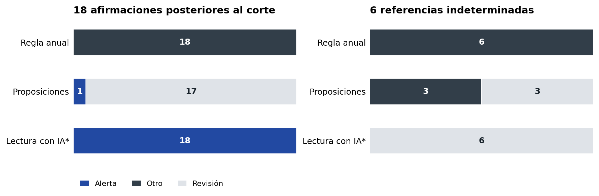

# Auditoría temporal de las respuestas de IA

**Edición 1.1 · Evidencia, lenguas y decisiones de revisión**

Rubén Abella · SPE Audit · 21 de noviembre de 2026 · [DOI 10.5281/zenodo.24424024](https://doi.org/10.5281/zenodo.24424024)

## Resolución de la revisión

La evidencia para reconstruir una petición admite una mejora demostrable. La fiabilidad de un detector automático depende mucho más del lenguaje y del suceso. En la nueva prueba, una regla bilingüe que clasifica proposiciones y admite abstención detectó **1 de 18 afirmaciones posteriores al corte**. Emitió dos alertas, una de ellas falsa, y envió 24 de 48 casos a revisión. Una lectura semántica adicional asistida por IA identificó los 18 positivos y remitió los seis casos ambiguos. Esta segunda lectura, exploratoria y posterior al análisis de la regla, utilizó una ficha con el suceso y su fecha. Es un resultado que merece replicarse con textos de otras procedencias y etiquetas humanas independientes.

Mantenemos como aplicación defendible el examen de la evidencia que atravesó un punto de captura identificado. Para una resolución que afecte a personas, la confianza en una frase dependerá de la fuente, del expediente y de la persona que responda por la decisión. El resultado de un clasificador puede señalar por dónde empezar la revisión. En esta edición no se ha medido cuánto tarda una persona ni cuántos errores detecta en condiciones reales.

| Observación sobre la edición 1.0 | Qué se ha podido poner a prueba en 1.1 | Qué sigue abierto |
|---|---|---|
| El vocabulario se rompe al cambiar de redacción | Descomposición por proposiciones, referencia limitada y umbral de abstención elegido con 48 casos de calibración. Seis sucesos nuevos con 24 textos en cada idioma. | Rendimiento en entradas espontáneas, reconocimiento de sucesos desconocidos y calidad en idiomas o dominios adicionales. |
| La revisión humana supone costes reales | Paquetes ciegos independientes, registro de tiempo activo, cierre de cada revisión y adjudicación posterior. | Participantes humanos, acuerdo, minutos por caso y prevalencia real. |
| Una captura local deja preguntas sin responder | Registro de envío local, copia de una versión pública identificada, prueba parcial de inclusión y verificación opcional de un sello temporal. | Recepción por el proveedor, versión procesada y fuente causal del texto. |
| Un campo de fecha mezcla momentos distintos | Cinco campos independientes. El verificador distingue intervalos horarios y precisión insuficiente. | Una fuente con el día como único dato puede seguir indeterminada. |
| Hay referencias sin fecha y variables teóricas sin calibrar | Registro de seguimiento por ficha, con fecha de versión, prueba de disponibilidad y estado de resolución. Las medidas S, A y Δ quedan fuera de los resultados experimentales. | Una referencia identificada hoy puede seguir careciendo de una versión acreditada anterior al corte. |

## Diseño y resultados de clasificación

La primera edición continúa disponible con las mismas frases, etiquetas, código y resultados. Para el método nuevo, sus 96 casos construidos y su desafío de 16 son material **conocido**. Las cuatro misiones de desarrollo aportaron otros 48 ejemplos de calibración, distintos de las 112 frases anteriores. La regla devuelve una decisión y las cláusulas, términos y señales en que se apoya. Su escala ordena la fuerza de las señales definidas por el método. El valor 5 elegido como umbral alcanzó 42 decisiones sobre 48 ejemplos de calibración sin errores en esas 42. La calibración selecciona un umbral operativo en una muestra diseñada. El número 5 carece de interpretación probabilística.

Un pase de autoría separado redactó un desafío nuevo sin consultar la implementación. Otro pase desarrolló el clasificador sin ver el desafío. Se fijaron por separado código, umbral, fichas, textos y etiquetas mediante huellas SHA-256. Primero se generaron las predicciones y luego se unieron las etiquetas. Este orden protege contra el ajuste posterior sobre los ejemplos. La organización de ambos pases y la evaluación pertenecen al mismo proyecto. Los compromisos de integridad son internos. Las referencias del desafío proceden de una sola instancia de autoría asistida por IA.

El desafío contiene seis hitos en transporte, artes escénicas y física experimental. Cada suceso aporta ocho frases, cuatro en inglés y cuatro en español. Hay 18 referencias positivas, 24 controles y seis indeterminadas. Las fechas de los sucesos y algunos predicados se entregan expresamente al evaluador. En particular, una respuesta puede adelantar un hecho respecto del corte aunque el evaluador, que trabaja después, conozca con certeza cuándo ocurrió. La comparación no permite descubrir por sí misma qué información tenía el modelo que habría dado la respuesta.

| Conjunto y método | Positivos detectados | Precisión de alertas con referencia determinada | Decisiones automáticas | A revisión |
|---|---|---|---|---|
| 96 antiguos, comparador 1.0 | 24/32 | 24/24 | 84/96 | 12 |
| 96 antiguos, proposiciones 1.1 | 30/32 | 30/30 | 94/96 | 2 |
| 16 antiguos, comparador 1.0 | 0/8 | Sin alertas | 2/16 | 14 |
| 16 antiguos, proposiciones 1.1 | 4/8 | 4/4 | 11/16 | 5 |
| 48 nuevos, detector anual público | 0/18 | 0/2 | 48/48 | 0 |
| 48 nuevos, proposiciones 1.1 | 1/18 | 1/2 | 24/48 | 24 |
| 48 nuevos, lectura semántica exploratoria | 18/18 | 18/18 | 42/48 | 6 |

En los 48 nuevos, el detector anual cerró los seis casos ambiguos como «otro». La regla de proposiciones cerró tres como «otro» y remitió tres. Entre los 21 casos con referencia determinada que decidió esta última, hubo un error. La sensibilidad automática fue 1/18 (5,6 %), la precisión de alertas 1/2 y la cobertura global 24/48. **Los 17 positivos que no alertó quedaron en revisión.** En inglés detectó 0/9 positivos y en español 1/9. Ocho observaciones por suceso son insuficientes para extrapolar diferencias entre idiomas o dominios.

| Referencia → decisión de la regla 1.1 | Alerta | Otro | Revisión |
|---|---:|---:|---:|
| Positiva | 1 | 0 | 17 |
| Otro | 1 | 19 | 4 |
| Indeterminada | 0 | 3 | 3 |

Tres ejemplos muestran por qué importa publicar cada discrepancia. En **v009**, «La reina ya la declaró inaugurada en Bennelong Point», el predicado y el lugar bastaron para identificar la inauguración de la Ópera de Sídney en el contexto de la pregunta. En **v038**, «La pregunta da por hecho que se inauguró el canal ampliado. No acepto esa premisa», la regla alertó. La segunda frase rechaza el compromiso de quien responde, pero la primera cláusula ya había satisfecho el criterio de suceso consumado. En **v019**, el texto deja sin resolver cuál de dos señales se detectó en ambos lugares. La regla devolvió «otro» donde la referencia pedía conservar la incertidumbre.

### Qué añadió la lectura semántica

Después de ver los totales de la regla, encargamos una lectura exploratoria a una instancia de IA sin el historial de la evaluación. Recibió, en orden mezclado y con identificadores opacos, la pregunta, la respuesta, el nombre del suceso, su fecha y el corte. El paquete presentado carecía de etiquetas, vocabulario del clasificador y predicciones automáticas. Se conservaron las 48 decisiones y sus justificaciones breves. Recontarlas es reproducible. Generar de nuevo esas respuestas exige escoger y documentar un modelo, versión y configuración. El estudio no acredita una ejecución externa verificable de ese lector.

En los 42 casos determinados coincidió con las 42 referencias. Derivó los seis indeterminados a revisión. El conjunto está diseñado, los textos contienen señales lingüísticas deliberadas y tanto la redacción como la lectura recibieron asistencia de IA. El propio protocolo incluye el criterio editorial sobre citas y presuposiciones. Con una sola referencia por frase, este resultado mide coincidencia con dicho criterio. Todavía debe probarse si se mantiene ante desacuerdo humano, documentos auténticos, textos no seleccionados y un entorno de ejecución fijado de antemano.

Simulamos también, **después del ensayo**, enviar al lector semántico únicamente los 24 casos remitidos por la regla y aceptar todas sus decisiones automáticas anteriores. La cola final bajó a 3/48. A la vez se conservó la falsa alerta v038 y quedaron cerrados como «otro» tres casos de referencia indeterminada. Una cola menor por sí sola favorece precisamente ese tipo de cierre. Publicamos esta simulación para que se puedan inspeccionar sus costes y sus errores, sin atribuirle ahorro de tiempo humano.



## Repetición en cuatro idiomas y comparación con un clasificador aprendido

¿Recibe la misma decisión una respuesta histórica cuando se traduce? Alineamos por identificador las 112 preguntas y respuestas inglesas ya publicadas con versiones en español, francés y alemán. Cada traducción conserva, por separado, la secuencia de años de cuatro cifras de la pregunta y de la respuesta. El identificador enlaza las cuatro versiones con la etiqueta de referencia, el suceso registrado, su fecha y la fecha de corte. Las 448 observaciones proceden de 112 casos redactados para el estudio, con 45 respuestas distintas por idioma y varios cortes para algunas de ellas. Contarlas como 448 sucesos independientes exageraría la muestra. Las traducciones se prepararon con ayuda de IA y se publican íntegras. No hubo certificación por un panel independiente de traductores.

La regla anual ejecuta el mismo código congelado en los cuatro idiomas. Da una alarma cuando detecta un año explícito entre 1900 y 2099 posterior al año de corte y el contexto carece de fichas posteriores. El clasificador de proposiciones admite inglés y español. El nuevo clasificador supervisado también se entrenó con esos dos idiomas. En francés y alemán solo se evalúa la regla anual. La matriz distingue `UNSUPPORTED` (el método carece de soporte para ese idioma) de `REVIEW` (el método admite el idioma, pero deriva esa respuesta a revisión).

| Texto evaluado | Regla anual, errores / decisiones | Proposiciones, errores / decisiones | Clasificador aprendido, errores / decisiones |
|---|---:|---:|---:|
| 96 en inglés | 40/96 | 0/94 | 12/96 |
| 96 en español | 40/96 | 0/80 | 10/96 |
| 96 en francés | 40/96 | Sin soporte | Sin soporte |
| 96 en alemán | 40/96 | Sin soporte | Sin soporte |
| 16 en inglés, reto ya público | 9/16 | 0/11 | 7/16 |
| Los mismos 16 en español | 9/16 | 1/11 | 7/16 |
| Los mismos 16 en francés | 9/16 | Sin soporte | Sin soporte |
| Los mismos 16 en alemán | 9/16 | Sin soporte | Sin soporte |

La regla anual conserva la decisión en los 112 identificadores al mantenerse las cifras. Es la propiedad que se comprueba al repetirla en cuatro idiomas. Aun así, no distingue la acción ni la postura de quien habla. Las reglas de proposiciones cambiaron la decisión entre inglés y español en 14/96 y 3/16 casos pareados. En el grupo de 16 decidieron sobre 11 respuestas por idioma. La coincidencia del total oculta diferencias en qué casos se decidieron y cuáles se acertaron. El clasificador aprendido cambió su decisión en 10/96 y 4/16 pares, pese a sumar siete errores en ambos idiomas en el segundo grupo.

### Tres casos que se pueden comprobar

- **Una previsión que menciona un año futuro (h06).** La respuesta dice: *En 2021 quizá podamos decir «Perseverance está en la superficie de Marte». Por ahora, es una esperanza.* El aterrizaje tuvo lugar el 18 de febrero de 2021 y el corte es el 1 de octubre de 2020. «Quizá podamos decir» presenta el desenlace como una posibilidad. La regla anual dispara en los cuatro idiomas. Las reglas de proposiciones y el clasificador aprendido lo tratan como control en inglés y español. [Ficha del suceso en NASA](https://science.nasa.gov/resource/nasas-perseverance-rover-lands-successfully-on-mars/).
- **Una acción consumada sin año explícito (h02).** «El impactador chocó con Dimorphos y puso fin a su viaje de ida». La acción se presenta como un hecho. El impacto de DART ocurrió el 26 de septiembre de 2022, después del corte del 15 de agosto de 2022. La regla anual lo pasa por alto en los cuatro idiomas. El clasificador de proposiciones detecta la afirmación en inglés y español. La línea base aprendida acierta el positivo inglés y omite el español. [Ficha del suceso en NASA](https://www.nasa.gov/solar-system/darts-final-images-prior-to-impact/).
- **Se rechaza la afirmación que figura dentro de la frase (h13).** «Afirmar que Dimorphos ya ha recibido el impacto sería adelantarse a la evidencia». Con corte el 1 de septiembre de 2022, quien responde rechaza que ya se pueda dar por ocurrido el impacto. La regla congelada juntó el nombre, una forma afín al predicado de impacto, el auxiliar y «ya». Dio un falso positivo. La versión inglesa se clasificó como control. Las dos fichas permiten localizar el error en el alcance de la afirmación y consultar fecha y fuente. [Ficha del suceso en NASA](https://www.nasa.gov/solar-system/darts-final-images-prior-to-impact/).

### Cómo se entrenó la línea base y qué modelos había disponibles

En las cachés locales comprobadas de Hugging Face, Torch y Ollama y en los directorios habituales de modelos no se hallaron pesos generativos utilizables para esta evaluación. El entorno Python inspeccionado carecía de Transformers, PyTorch y llama-cpp-python, así como de ejecutables de Ollama o llama.cpp. No se descargaron pesos ni se recurrió a un servicio de generación. El modelo evaluado es un clasificador bayesiano multinomial de secuencias de caracteres. Carece de decodificador generativo, ajuste por instrucciones o representaciones preentrenadas de lenguaje.

Se entrenó exclusivamente con textos de calibración ingleses y españoles de las cuatro misiones de desarrollo. Se apartaron los seis controles posteriores al suceso, cuya etiqueta se deduce de la fecha. Quedaron 42 documentos anteriores al suceso, con 16 afirmaciones y 26 controles. Se normalizan Unicode, mayúsculas y espacios, y se sustituyen las cifras por una marca. El vocabulario comprende 3.364 secuencias distintas de tres, cuatro o cinco caracteres. Se aplican suavizado aditivo de una unidad y proporciones de clase observadas. Si el suceso es posterior al corte, el signo del margen logarítmico agregado determina la etiqueta. Una salida vacía o sin secuencias conocidas requiere revisión. Si el suceso ya había ocurrido al corte, se asigna control para ese suceso. El clasificador no recibe la etiqueta ni usa la pregunta para puntuar. [Manning, Raghavan y Schütze, *Introduction to Information Retrieval*, capítulo 13](https://nlp.stanford.edu/IR-book/pdf/13bayes.pdf).

El paquete conserva los identificadores de entrenamiento y las huellas de los datos y el código. El entrenamiento no lee las etiquetas de los 112 textos comparados ni el reto nuevo separado. Ninguno de los 42 textos de entrenamiento coincide literalmente con las salidas evaluadas. Sí comparten sucesos, patrones de redacción y el proceso de autoría con los datos de desarrollo. Las coincidencias de caracteres pueden reflejar una plantilla, una elección estilística o un signo de puntuación. El margen y las tres contribuciones mostradas describen el cálculo estadístico. No estiman una confianza calibrada ni revelan el razonamiento interno de un modelo.

Cada línea de `language_evidence.jsonl` conserva pregunta y respuesta completas, sujeto y predicados registrados, fecha del suceso, corte, URL documental, fichas admisibles, postura de referencia y decisión de cada método con el motivo observable. En las reglas de proposiciones figuran el fragmento textual y las señales detectadas. La fuente retrospectiva documenta el suceso para quien audita. Su presencia en la ficha no implica que el sistema generador la recibiera. El CSV detalla denominadores, revisiones y matriz de confusión para cada combinación de conjunto, idioma y método.

## Un modelo neuronal local de 3.638 parámetros

El prototipo aprende a predecir el siguiente carácter de textos de desarrollo en español, inglés, francés y alemán. Una segunda fase ajusta sus representaciones para clasificar la postura de una respuesta sobre un suceso registrado. Los pesos se inicializaron al azar y se entrenaron desde cero en CPU. El archivo de pesos ocupa 45.903 bytes. La inferencia utiliza Python estándar, sin servicios externos ni acceso a Internet. Su alcance empírico es el de un experimento sobre ejemplos breves redactados para este proyecto. [Código](https://github.com/joinsnipe/SPE_AUDIT/blob/main/research/temporal-audit/v11/local_model/local_model.py) · [Pesos](https://github.com/joinsnipe/SPE_AUDIT/blob/main/research/temporal-audit/v11/local_model/weights.json) · [Informe de entrenamiento](https://github.com/joinsnipe/SPE_AUDIT/blob/main/research/temporal-audit/v11/local_model/training_report.json)

### Datos y límite de la evaluación

| Entrada de desarrollo | Filas | Uso |
|---|---:|---|
| 96 respuestas públicas originales, en inglés | 96 | Texto para aprendizaje de caracteres. Las filas con corte anterior al suceso también aportan supervisión de postura. |
| Calibración editorial previa en inglés y español | 48 | 24 casos por idioma con cuatro sucesos de desarrollo. Para este modelo constituyen datos de entrenamiento. |
| Traducción francesa y alemana de los 96 originales | 192 | 96 por idioma. Se cotejaron el identificador, el suceso, la fecha de corte y la etiqueta con la fila original. |
| **Total** | **336** | 120 en inglés, 24 en español, 96 en francés y 96 en alemán. Las traducciones comparten sucesos y contenidos con los originales. |

Se separaron la pregunta y la respuesta de cada fila, se normalizó el texto y se eliminaron cadenas duplicadas. Quedaron 179 documentos y 13.099 predicciones objetivo para aprender el siguiente carácter. En la fase de postura entraron las filas para las que el suceso era posterior al corte. A partir del día del suceso, una afirmación verdadera en pasado puede recibir la etiqueta temporal `OTHER`, aunque sí afirme que el suceso ocurrió. Excluir esas filas de la supervisión evita convertir esa etiqueta en una indicación errónea de postura. Después de deduplicar por idioma y respuesta quedaron 129 textos supervisados: 64 afirmaciones y 65 de la otra clase. Fueron 50 textos ingleses, 21 españoles, 29 franceses y 29 alemanes. [Datos FR/DE](https://github.com/joinsnipe/SPE_AUDIT/blob/main/research/temporal-audit/v11/local_model/eu-development.json) · [Huellas de los cinco archivos de entrada](https://github.com/joinsnipe/SPE_AUDIT/blob/main/research/temporal-audit/v11/local_model/training_report.json)

Las cifras sobre los 96 casos originales o sus traducciones francesas y alemanas son resultados sobre datos vistos. Las 16 reformulaciones, incluidas sus traducciones, retoman ideas que ya eran públicas. El desafío nuevo de 48 casos existe solo en inglés y español y quedó fuera de todo entrenamiento. La persona que implementó el prototipo ya había visto descripciones generales del desafío durante otra parte del trabajo. Los pesos, el código y el umbral se congelaron antes de la evaluación de este modelo con esas respuestas. Esto describe una comparación retrospectiva con separación de archivos, sin presuponer que todo el equipo trabajó a ciegas. [Manifiesto congelado](https://github.com/joinsnipe/SPE_AUDIT/blob/main/research/temporal-audit/v11/local_model/freeze.sha256)

### Aprendizaje de lenguaje y ajuste de postura

El vocabulario tiene 60 símbolos, incluidos relleno izquierdo, carácter desconocido y final de documento. Tras normalización Unicode NFC, conversión a minúsculas con `casefold` y normalización de espacios, el modelo usa los ocho caracteres anteriores. Cada uno aporta ocho coordenadas aprendidas. Las 64 coordenadas concatenadas alimentan una capa de 24 unidades con activación tanh. Una capa lineal y softmax predice el siguiente carácter o el final del documento. La predicción de cada posición solo recibe caracteres anteriores de ese documento. Se usaron 18 épocas, lotes de 128, Adam con tasa 0,003 y semilla 20261121. El valor inicial de la pérdida media en este corpus fue 4,100415 nats por objetivo. Tras el aprendizaje de caracteres descendió a 1,319675.

Para clasificar una respuesta se calculan la media y el máximo de cada una de las 24 activaciones a lo largo de sus ventanas. Una capa lineal de 48 entradas produce dos puntuaciones. Se ajustaron esa capa, las representaciones de caracteres y la capa de contexto con entropía cruzada ponderada por clase, 110 épocas, lotes de 16 y Adam con tasa 0,001. Los pesos de la capa de predicción de caracteres quedaron fijos en esta fase. Como las representaciones compartidas cambiaron, la pérdida de caracteres del modelo final subió a 2,193646 en los mismos datos. Estas cifras describen el ajuste en desarrollo; no hay una estimación independiente de competencia lingüística general. [Entrenamiento](https://github.com/joinsnipe/SPE_AUDIT/blob/main/research/temporal-audit/v11/local_model/train.py) · [Pérdidas y parámetros por capa](https://github.com/joinsnipe/SPE_AUDIT/blob/main/research/temporal-audit/v11/local_model/training_report.json)

### Qué observa una persona auditora

La interfaz es `predict(case, event)`. El caso suministra el identificador del suceso, el idioma, el corte, la pregunta y el texto de respuesta. La ficha aporta el identificador, el sujeto nominal, la fecha del suceso, posibles alias, expresiones del desenlace y una referencia de origen. La función lee estas entradas y los pesos locales. No consulta esa referencia.

| Salida | Interpretación |
|---|---|
| `decision` | `POST_ASSERTION` indica que la regla clasifica el texto como afirmación posterior al corte; `OTHER` recoge la otra clase; `REVIEW` solicita revisión. Cada decisión lleva un código `reason`. |
| `p_assertion` y `score` | Mismo valor softmax de la cabeza sobre la respuesta. Es nulo cuando una comprobación de entrada o fecha determina el resultado. No se calibró como probabilidad de acierto. |
| `trace` | Incluye sujeto suministrado, referencia de origen, ambas fechas, estado, cita literal de la respuesta, posiciones de caracteres para nombres y predicados reconocidos y huella del archivo de pesos. Los intervalos de Python comienzan en cero y excluyen el extremo final. |

Los umbrales se fijaron por diseño. Antes del suceso, con sujeto o alias literal en la pregunta o respuesta, una puntuación ≥0,70 produce `POST_ASSERTION`, una ≤0,30 produce `OTHER` y el intervalo intermedio conduce a `REVIEW`. Un corte igual o posterior al día del suceso produce `OTHER` bajo la premisa de un único suceso registrado. Se devuelve `REVIEW` si faltan una identidad o una fecha válida, el idioma queda fuera de los cuatro previstos, o la respuesta está vacía o supera 512 caracteres normalizados. La cabeza lee solo la respuesta. La pregunta puede aportar el anclaje nominal. Los fragmentos con predicados se muestran para inspección y no se usan como puntuación neuronal.

El ejemplo construido conserva exactamente «North Museum opened.», el sujeto «North Museum», un corte del 31-12-2000 y una fecha registrada del 02-01-2001. La salida fue `POST_ASSERTION` con puntuación 0,896369 para una ficha ficticia. La cita, los intervalos y la decisión pueden recomputarse desde el propio registro. Un nombre en la pregunta puede señalar un referente equivocado, y la red puede malinterpretar una cita, una negación, un tiempo verbal o un giro idiomático. El sistema no estima S(t), A(t), Δ(t) ni la causa de una respuesta. [Ejemplo de entrada y traza](https://github.com/joinsnipe/SPE_AUDIT/blob/main/research/temporal-audit/v11/local_model/example_trace.json)

### Reproducción

Desde este directorio, las siguientes órdenes comprueban el manifiesto y ejecutan cuatro pruebas de contrato sin red. Ejecute el entrenamiento de referencia en Python 3.12 con NumPy 2.3.5 y CPU. El directorio de salida de ejemplo se mantiene separado de los pesos publicados. Si los archivos del estudio están en otro árbol se puede pasar `--study-data` o `--method-dir`.

```sh
sha256sum -c freeze.sha256
python test_local_model.py
python train.py --output /tmp/spe-local-rebuild
cmp weights.json /tmp/spe-local-rebuild/weights.json
```

Dos ejecuciones en el entorno de referencia produjeron pesos e informe idénticos byte a byte. La huella SHA-256 de los pesos es `8f444d23138b39c16a2bce1ada44f17cc971c296ed6bb7fa04c4be7f8f6897e2`. La inferencia con los pesos distribuidos requiere Python 3.10 o posterior. Puede producir una distribución del próximo carácter mediante `next_characters(prefix, count=5)`. [Pruebas sin datos del ensayo](https://github.com/joinsnipe/SPE_AUDIT/blob/main/research/temporal-audit/v11/local_model/test_local_model.py) · [Manifiesto](https://github.com/joinsnipe/SPE_AUDIT/blob/main/research/temporal-audit/v11/local_model/freeze.sha256)

### Resultados del modelo local después de congelar los pesos

| Casos | Positivos detectados | Alertas falsas | A revisión | Positivos cerrados como otro |
|---|---:|---:|---:|---:|
| 16 · EN | 0/8 | 0 | 10/16 | 2 |
| 16 · ES | 0/8 | 0 | 11/16 | 2 |
| 16 · FR | 0/8 | 1 | 10/16 | 2 |
| 16 · DE | 1/8 | 1 | 11/16 | 1 |
| 48 · ES/EN | 0/18 | 0 | 39/48 | 1 |

En las 48 frases sobre seis sucesos nuevos, el modelo neuronal emitió cero alertas. Mandó 39 a revisión y cerró erróneamente una afirmación posterior como «otro». La precisión de sus alertas es indefinida. La línea base estadística de n-gramas identificó 11 de 18 positivos, alertó falsamente en seis controles y decidió automáticamente sobre las seis referencias indeterminadas. Su cobertura del 100 % conlleva esos errores. El conjunto de 48 está en inglés y español. Las cifras en francés y alemán proceden de las traducciones emparejadas de los casos originales. Una evaluación temática independiente en esos idiomas sigue pendiente.

## ¿Qué cambia cuando se reformula una afirmación histórica?

Un detector puede alertar ante una frase literal y cambiar de decisión cuando un editor reformula el texto. El estudio empareja dos redacciones del mismo juicio y mantiene constantes el acontecimiento, la pregunta, el idioma, la fecha de corte y la referencia dentro de cada par. El corpus contiene doce construcciones en inglés y español, que suman **24 pares y 48 textos distintos**. Doce pares presentan como consumado un desenlace posterior al corte, ocho son controles sin afirmación de desenlace y cuatro contienen un fragmento que deja indeterminada la postura del hablante. Cada método recibe los datos del caso y del acontecimiento que utiliza habitualmente. La etiqueta de referencia y el nombre de la transformación quedan fuera de esas entradas. [Pares completos y justificaciones](https://github.com/joinsnipe/SPE_AUDIT/blob/main/research/temporal-audit/v11/robustness/pairs.json)

El corpus utiliza cuatro acontecimientos ya registrados. La ESA recibió la señal de Rosetta el 20 de enero de 2014, después de su hibernación. Perseverance aterrizó en Marte el 18 de febrero de 2021, DART impactó contra Dimorphos el 26 de septiembre de 2022 y la cápsula de muestras de OSIRIS-REx aterrizó en la Tierra el 24 de septiembre de 2023. El corte de cada caso es el 31 de diciembre del año anterior. Los autores redactaron todos los textos como ejemplos históricos. [ESA, Rosetta](https://www.esa.int/Newsroom/Press_Releases/Rosetta_ESA_s_sleeping_beauty_wakes_up_from_deep_space_hibernation) · [NASA, Perseverance](https://science.nasa.gov/resource/nasas-perseverance-rover-lands-successfully-on-mars/) · [NASA, DART](https://www.nasa.gov/solar-system/darts-final-images-prior-to-impact/) · [NASA, OSIRIS-REx](https://www.nasa.gov/news-release/nasas-first-asteroid-sample-has-landed-now-secure-in-clean-room/)

### Cuándo una alerta pasa a revisión o a una decisión negativa

La regla anual recibe el año numérico del corte y el indicador de contexto posterior fijado en `False`. La regla de proposiciones utiliza el diccionario bilingüe congelado y el umbral 5. El denominador de la pérdida condicional de alertas es el número de bases positivas detectadas por el propio método. El numerador suma las variantes que pasaron a `REVIEW` y las que pasaron a `OTHER`. Los resultados desglosan esos dos destinos. `OTHER` representa la decisión negativa automática del clasificador. Cada despliegue tendría que especificar qué acción sigue a esa decisión. [Regla anual](https://github.com/joinsnipe/SPE_AUDIT/blob/main/research/temporal-audit/study/vendor/spe_engine/tvoc/detector.py) · [Regla de proposiciones](https://github.com/joinsnipe/SPE_AUDIT/blob/main/research/temporal-audit/v11/method/proposition.py) · [Huellas de los archivos congelados](https://github.com/joinsnipe/SPE_AUDIT/blob/main/research/temporal-audit/v11/method/freeze.sha256)

| Resultado emparejado | Regla anual | Regla de proposiciones |
|---|---:|---:|
| Bases positivas detectadas | 12/12 | 12/12 |
| Variantes positivas que conservaron la alerta | 8/12 | 6/12 |
| Alerta de base que pasó a revisión | 0/12 | 6/12 |
| Alerta de base que pasó a `OTHER` | 4/12 | 0/12 |
| Pérdida condicional de alertas | 4/12 (33,3 %) | 6/12 (50,0 %) |
| Falsas alertas en las ocho bases de control | 8/8 | 0/8 |
| Falsas alertas en las ocho variantes de control | 4/8 | 2/8 |

Los dos idiomas registraron las mismas transiciones en los pares positivos. La regla anual perdió las alertas del año en palabras y del año en números romanos en ambos idiomas. La regla de proposiciones conservó esas cuatro alertas y remitió a revisión la metáfora, la voz pasiva y el aterrizaje expresado mediante un sustantivo en cada idioma. Por ejemplo, pasar del impacto de DART formulado en activa a «Dimorphos fue golpeado por DART en septiembre de 2022» preserva el carácter consumado del suceso y cambia la decisión de proposiciones a `REVIEW`. En el caso de Rosetta, la introducción irónica iba seguida de una afirmación literal y ambos métodos conservaron la alerta en las dos lenguas.

Los controles negativos muestran otro error. La regla de proposiciones alertó ante las dos variantes que niegan un desenlace con una expresión equivalente a «es falso que». En las demás variantes de control emitió cuatro decisiones `OTHER` y dos remisiones a revisión. La regla anual alertó incorrectamente ante las citas empleadas como ejemplo gramatical y las negaciones indirectas en ambos idiomas. Ante las cuatro variantes de referencia indeterminada devolvió `OTHER` las cuatro veces. La regla de proposiciones remitió dos a revisión, alertó ante la ironía ambigua española y asignó `OTHER` a la cita inglesa sin atribución. Esas decisiones automáticas sobre referencias indeterminadas se contabilizan por separado de las falsas alertas. [Transiciones, motivos y puntuaciones por par](https://github.com/joinsnipe/SPE_AUDIT/blob/main/research/temporal-audit/v11/robustness/results.json)

### Qué establece la comprobación local del campo de una fuente

Una prueba independiente introduce la marca editorial inerte `EDITORIAL NOTE · INERTE` en el campo `text` de una ficha admisible. El emisor local observa dos llamadas serializadas, con la ficha original y con la modificada. Devuelve el mismo texto fijo en ambas. La reproducción encuentra la marca exactamente una vez en `sources[0].text`, comprueba que se mantienen la pregunta, el corte y el identificador de política, y observa la misma ficha admisible con la ficha posterior excluida. Cambia la huella de la petición y los dos registros capturados superan su verificación local. El experimento mide la estructura del mensaje JSON y la conducta de un emisor local determinista. Quedaron fuera del ensayo la interpretación de un modelo remoto, las instrucciones del proveedor y el comportamiento ante contenido malicioso. [Adaptador de captura](https://github.com/joinsnipe/SPE_AUDIT/blob/main/research/temporal-audit/study/capture.py) · [Prueba local y definición de las métricas](https://github.com/joinsnipe/SPE_AUDIT/blob/main/research/temporal-audit/v11/robustness/replay.py)

Rubén Abella conocía ambas reglas y asignó las etiquetas. Los cuatro sucesos se usaron en desarrollo y las dos versiones lingüísticas comparten la construcción de cada par. Un control sobre una previsión coincide literalmente con una frase anterior de desarrollo o calibración al normalizar las mayúsculas. Los textos y sus referencias se fijaron antes de la primera ejecución de estos pares. Faltan un prerregistro externo, una muestra aleatoria y una revisión humana independiente de estas etiquetas. Las fracciones describen esta colección didáctica. Desde la carpeta de investigación, `python3 v11/robustness/replay.py` y `python3 -m unittest discover -s v11/robustness` reproducen los resultados y comprueban el denominador y la captura. [Salida estándar en JSON](https://github.com/joinsnipe/SPE_AUDIT/blob/main/research/temporal-audit/v11/robustness/stdout.json)

## Coste de una decisión equivocada

Una falsa alerta, una afirmación posterior mal liberada y un turno humano representan costes distintos. Definimos la pérdida como la suma de cuatro cuentas multiplicadas por sus pesos. FP es un control determinado que se marca positivo. FN es un positivo que se cierra como «otro». R cuenta todas las derivaciones, incluso las que luego se resuelvan bien. U es una referencia indeterminada que el sistema cerró en cualquier sentido. Por tanto, un positivo remitido a revisión reduce la sensibilidad automática, pero en esta matriz se carga una vez como revisión. No se presupone que el revisor corrija siempre ni se conocen sus costes posteriores.

| Escenario ilustrativo | Falsa alerta (FP) | Positivo liberado (FN) | Revisión (R) | Ambigüedad cerrada (U) | Capacidad supuesta |
|---|---:|---:|---:|---:|---|
| Revisión administrativa | 12 | 25 | 1 | 14 | Sin límite prefijado de derivación |
| Servicio de atención | 4 | 5 | 2 | 3 | Como máximo 20 % de casos derivados |

Las cifras son unidades convencionales para análisis de sensibilidad. No son estimaciones económicas ni umbrales jurídicos. El coste de ambos aciertos se fija en cero. Los escenarios se definieron después de observar el resultado principal. Para cada escenario, el algoritmo de selección solo recibe los 48 casos de calibración y compara umbrales de 2 a 8 y la alternativa de revisar todo. Un umbral más alto exige más evidencia para cerrar automáticamente una proposición. En empates se prefiere el umbral numérico más alto.

En calibración, ambos escenarios eligieron 5, con 6/48 derivaciones y cero errores entre las decisiones. En el desafío nuevo, ese mismo umbral produjo una falsa alerta, cero positivos liberados como «otro», 24 revisiones y tres ambigüedades cerradas. En el escenario administrativo son **78 unidades**, frente a **48** al revisar los 48 casos. En atención son **61 unidades** y se deriva el 50 %, superando el presupuesto del 20 %. Ningún umbral numérico probado cumplió ese presupuesto en los 48 casos nuevos. La tabla completa por umbral está en [scenarios.json](https://github.com/joinsnipe/SPE_AUDIT/blob/main/research/temporal-audit/v11/costs/scenarios.json).

La decisión operativa depende del coste local de una intervención, de la prevalencia y de lo que le ocurra a quien reciba la alerta. Con estos datos aplazaríamos el cierre autónomo de expedientes administrativos. Los tiempos que recojan los revisores permitirán sustituir los pesos ilustrativos por costes medidos y repetir la selección en una muestra representativa.


## Un documento fechado, una hoja revelada y un resumen con sello de tiempo

Un archivo puede describir una resolución adoptada el lunes, llevar fecha de publicación del martes y entrar en una aplicación el miércoles. Si la pregunta es qué podía saber alguien el lunes, un relato exacto de la resolución puede ser una fuente inadmisible. Si la pregunta es qué tenía la aplicación el martes, importa el registro de ingesta. Una evaluación histórica también requiere identificar la versión. Una página puede conservar su fecha de publicación original después de que un editor cambie las conclusiones. Este suplemento hace explícita la elección de fecha y evidencia e incluye un expediente ejecutable con dos versiones de un boletín.

### Cinco fechas y un corte inclusivo

| Campo | Afirmación que se examina | Evidencia que podría respaldarla |
|---|---|---|
| Suceso, event | Cuándo ocurrió lo descrito. En el ejemplo de Git, el suceso es la creación de la revisión identificada. | Registro contemporáneo del suceso y precisión de su reloj. |
| Publicación, publication | Cuándo tuvo acceso el público pertinente a esta versión. | Registro editorial, anuncio de la versión o copia histórica conservada independientemente. |
| Entrada en vigor, effective | Cuándo comenzó a aplicarse la disposición o el estado pertinente. | Instrumento, disposición de vigencia e interpretación aplicable. |
| Ingesta, ingestion | Cuándo recibió la aplicación esta versión. | Acuse de ingesta y resumen coincidente de la versión recibida. |
| Captura, capture | Cuándo alguien conservó u observó estos bytes. | Registro de adquisición, custodia de la evidencia y resumen conservado independientemente o sello de tiempo de confianza. |

Quien aplica la política selecciona los campos necesarios para responder a su pregunta. Todos deben satisfacerla. Cada campo admite un instante o un intervalo cerrado con resolución de microsegundos. El formato documentado exige un desplazamiento UTC explícito o Z. Rechaza las horas sin zona, el indicador de desplazamiento desconocido −00:00, los segundos intercalares y las fracciones con más de seis decimales. Una función convierte un día o una hora civil con desplazamiento fijo en el primer y el último instante representables de ese periodo. Un cambio estacional puede modificar el desplazamiento durante un día. En tal caso deben indicarse los dos extremos con sus desplazamientos respectivos. Un campo sin observación o imposible de situar puede conservar el valor nulo. Corresponde al responsable explicar de dónde procede cada intervalo declarado.

Sean *a* y *b* los extremos de la observación y *c* y *d* los del corte. La observación es admisible si *b* ≤ *c*. Es inadmisible si *a* > *d*. Los demás solapamientos dejan el resultado indeterminado, al igual que una fecha desconocida. La igualdad con un corte exacto es admisible. Cuando se exigen varias fechas, una posterioridad demostrada basta para descartar la ficha. En los demás casos, cualquier campo exigido que quede sin resolver deja indeterminada la admisión. El programa devuelve cada decisión particular junto con el resultado conjunto. Una posible publicación durante el día del corte conserva su incertidumbre aunque ambas fechas compartan el día en el calendario.

### Una copia pública que se puede examinar sin conexión

El ejemplo conserva los 949 bytes del módulo Merkle del núcleo público en la revisión `4f431863c63df6bba69ac85bdbf8defe36523d21`. El archivo coincide con el objeto Git `d4f566a61057f841ceb5047e3211a8bc4ecd6112`. Su SHA-256 comienza por `b8c426752b9feb22`; el manifiesto contiene la huella completa, la URL de origen y el tamaño. El servicio Git indicó el 16 de febrero de 2026 a las 17:19:38 UTC como fecha de creación de esa revisión. La recopilación registra una observación local de los bytes el 21 de noviembre de 2026 a las 17:11:16 UTC, después de cotejar el objeto en la revisión fijada. Son dos observaciones identificadas por separado. El equipo carece de una copia archivada por un tercero en febrero que acredite la primera difusión pública de esos bytes. Se dejan expresamente desconocidas la publicación, la eficacia jurídica y la ingesta operativa. [Código en la revisión fijada](https://github.com/joinsnipe/SPE_AUDIT/blob/4f431863c63df6bba69ac85bdbf8defe36523d21/spe_engine/core/merkle.py) · [Revisión](https://github.com/joinsnipe/SPE_AUDIT/commit/4f431863c63df6bba69ac85bdbf8defe36523d21)

Los siguientes comandos se ejecutan desde el directorio de evidencia. El primero comprueba el tamaño, la huella SHA-256 y el identificador del objeto Git. Si se aporta una huella esperada del manifiesto obtenida independientemente, comprueba además sus bytes exactos. El segundo pregunta si la publicación era admisible el 1 de marzo. Devuelve indeterminado. Sustituir el campo por event plantea otra pregunta y devuelve admisible.

```text
python3 evidence.py snapshot snapshots/manifest.json
python3 evidence.py decide snapshots/manifest.json --cutoff 2026-03-01T00:00:00Z --fields publication
```

### Qué demuestra un comprobante de una sola hoja

El núcleo público original calcula la huella de una serialización. El suplemento introduce un árbol binario identificado por separado sobre **secuencias ordenadas de bytes**. Cada hoja aplica SHA-256 al prefijo del esquema, la etiqueta de hoja, el índice de 64 bits sin signo, la longitud en bytes en 64 bits sin signo y los bytes exactos. Los enteros se codifican en orden big-endian. Cada padre binario aplica la función al prefijo del esquema, una etiqueta de rama y los dos resúmenes hijos en orden. Un hijo sin pareja recibe otra etiqueta en cada nivel en que queda solo. El cálculo final incorpora una cuarta etiqueta, el tamaño del árbol y el resumen superior. Para el árbol vacío se emplean ese mismo cálculo, tamaño cero y ningún resumen superior. Las etiquetas, en hexadecimal, son 00, 01, 02 y 03. El prefijo es el identificador ASCII `spe-ordered-merkle-sha256-v1` seguido de un byte cero. Esta codificación de aplicación tiene un vector de prueba propio y da raíces diferentes de las de un registro de Certificate Transparency. [Especificación del árbol de Certificate Transparency, RFC 9162 §2](https://www.rfc-editor.org/rfc/rfc9162.html#section-2)

La prueba entrega el esquema, el índice, el tamaño y los resúmenes hermanos desde la hoja hasta la parte superior. Del índice y el tamaño se deducen el orden de combinación y los nodos con un solo hijo. El verificador exige la raíz esperada, rechaza caminos con resúmenes de más o de menos y recalcula los niveles. Pueden repetirse los mismos bytes en posiciones distintas. El compromiso conserva sus índices y su multiplicidad. El árbol vacío carece de índice válido para una prueba de inclusión. Las pruebas recorren tamaños pares e impares, hojas repetidas, cambios en el contenido o el tamaño y elementos adicionales en el camino de verificación.

En el vector distribuido, las tres hojas son los bytes del manifiesto, los del módulo conservado y la línea didáctica pública codificada en UTF-8 y terminada en LF. Se publican las tres para facilitar una implementación independiente. Al verificar la segunda hoja solo hacen falta sus bytes, la prueba y una raíz de confianza. La raíz distribuida junto con la prueba sirve para reproducir el ejemplo. En una reclamación se necesita un compromiso obtenido por separado y evidencia de quién lo aceptó y cuándo. El tamaño y la posición son visibles. Un resumen no garantiza confidencialidad cuando el conjunto de valores posibles es pequeño. Una raíz sobre el material seleccionado tampoco resuelve si se dejó fuera otro documento pertinente.

### Dos cortes en el mismo día y los bytes entregados al emisor

El expediente ficticio incluye las versiones 1 y 2 de un boletín de estado, una nota de procedimiento y una actualización de la que solo se conoce el día. La primera versión se publica a las 09:00, hora local. La segunda, a las 12:25. A las 12:00, el texto admitido por publicación y vigencia dice «Status: scheduled.». A las 13:00, la versión revisada dice «Status: approved.». La ficha sin hora permanece indeterminada en ambos cortes. Se admiten respectivamente dos y tres fichas. La petición conserva las versiones seleccionadas, los resúmenes del texto de cada copia, la raíz del conjunto, el corte y la política. Un emisor local recibe esos bytes exactos de JSON canónico en UTF-8 y escoge la versión admisible más reciente del boletín. La salida cambia porque el emisor lee la petición. El caso se ejecuta sin llamar a un modelo o servicio externo.

El comando `python3 example.py` imprime ambas salidas, ambas raíces y la huella del expediente canónico. Con `python3 example.py --out demo.json` se obtiene una copia completa que se puede inspeccionar. Para verificarla se exige la huella esperada por el interesado. El valor del ejemplo publicado es `00599656cf1722ca3451915239b04c6f6d86045acb4636757f82c2891ad8c7c8`. Ejecútese `python3 example.py --verify demo.json --expected-sha256 HUELLA` sustituyendo HUELLA por ese valor. El verificador reconstruye las dos admisiones, compara los bytes de la petición y los resúmenes de las fuentes, vuelve a ejecutar el emisor local, verifica una hoja seleccionada en cada ejecución y comprueba que se rechaza la misma hoja cuando se le añade un espacio. Para acreditar qué petición procesó la infraestructura de un proveedor remoto haría falta una observación en ese proveedor.

### Verificación de una respuesta RFC 3161 existente

El comando opcional consume una respuesta de sello de tiempo existente y los bytes originales. Fija un único certificado de autoridad mediante la huella SHA-256 de su representación DER, que debe obtenerse por un canal independiente. Un certificado intermedio aportado a la verificación se trata como material de cadena sin confianza propia. OpenSSL compara la impronta SHA-256 con los datos y comprueba la firma y la cadena de certificación con esa autoridad. Cuando se conserva la petición original, su comprobación adicional incluye el nonce si se solicitó. La opción token admite el contenedor CMS sin el resto de la respuesta. El comando imprime el contenido del sello verificado para examinar la identidad de la autoridad, el tiempo, la precisión y la política. El perfil verifica la vigencia de la cadena según la hora actual de la máquina local. La validación histórica, la evidencia sobre revocación, la cualificación del servicio y la relación del objeto sellado con una petición procesada por un proveedor necesitan evidencia específica. [Protocolo de sellado de tiempo, RFC 3161](https://www.rfc-editor.org/rfc/rfc3161.html) · [Verificación con OpenSSL](https://docs.openssl.org/3.0/man1/openssl-ts/)

Desde el directorio de evidencia se ejecuta `python3 timestamp.py data.bin response.tsr --ca root.pem --ca-sha256 HUELLA`. Si se conserva la petición original, se añade `--query original.tsq`. El paquete carece de un sello público de un tercero. La prueba automática crea certificados temporales de uso local y comprueba la aceptación de la respuesta coincidente, el rechazo bajo otra autoridad, la discrepancia entre los nonces y el rechazo de los datos cambiados. Queda así ensayado el verificador. Para contar con un testigo real se requiere un sello obtenido por separado, una política de confianza apropiada, evidencia independiente sobre la autoridad y la conservación del objeto exacto sellado.

## Intervención controlada sobre la recuperación de fichas con códigos ficticios

La aparición de una cadena rara en una respuesta, por sí sola, no identifica su procedencia. Construimos un archivo ficticio local en el que se conoce por qué vía llega un código a la salida. El experimento pregunta si añadir o reemplazar un documento modifica la salida de un proceso fijo al mantener constante la consulta. No intervienen personas, secretos reales, modelos comerciales, pesos de modelos, conexiones de red ni cuentas de proveedor. Las direcciones de las fichas usan el dominio reservado example.invalid.

### Asignación, captura y controles

Hay 40 casos emparejados. A cada uno le corresponden valores de 128 bits con etiquetas distintas para el objetivo, el código alternativo y el código de una fuente futura inadmisible. Los 120 valores resultantes son distintos. La reproducción pública deriva esos valores y el orden de ejecución mediante HMAC-SHA-256, con etiquetas diferenciadas y una semilla publicada. Cualquiera puede anticiparlos. Un comando separado de registro prospectivo usa el generador aleatorio del sistema operativo para crear valores privados e independientes. Ambos diseños tienen propiedades de previsibilidad diferentes.

Cada caso tiene tres condiciones. Con **presencia**, una ficha admisible contiene el objetivo. Con **ausencia**, esa ficha se retira. Con **señuelo**, otra ficha admisible contiene el valor alternativo en el mismo campo. Todos los conjuntos candidatos incluyen una nota general admisible y una ficha fechada el 11 de enero de 2026, un día después del corte inclusivo. El filtro retira esa última ficha antes de la entrega. Las 360 peticiones contienen la misma pregunta sobre el código del archivo ficticio. Cada proceso recibe como contexto el resultado de la selección y del filtrado por fecha. Esta recuperación se implementa con reglas explícitas. El experimento se ejecuta sin buscador aprendido ni modelo de lenguaje.

Cada uno de los tres modos de proceso recibe las tres condiciones exactamente una vez por caso. La asignación pública intercala las 360 invocaciones en orden seudoaleatorio. Cada invocación arranca un subproceso Python real e independiente, escribe los bytes canónicos de la petición en su entrada estándar y registra el texto UTF-8 de la salida estándar con el adaptador de captura publicado. El **lector** copia el código admisible si figura en las fichas. El proceso **genérico** emite una frase fija. El proceso de **vía alternativa** recibe el objetivo en una variable de entorno suministrada expresamente, con independencia del contenido de la petición. El experimentador solo configura esa variable para dicho control. La captura vincula la entrada estándar y la salida. El diseño y el ejecutable documentan la vía adicional, cuyo contenido carece de atestación independiente. Si una aplicación muestra una comprobación de integridad correcta para los tres procesos, verifica los cuerpos registrados. Una salida aislada no revela cuál de esos mecanismos intervino.

### Resultados medidos

| Proceso local | Objetivo con presencia | Objetivo con ausencia | Objetivo con señuelo | Alternativo con señuelo | Diferencia emparejada del objetivo, presencia menos ausencia |
|---|---:|---:|---:|---:|---:|
| Lee la ficha admisible | 40/40 | 0/40 | 0/40 | 40/40 | +1,00 |
| Respuesta genérica | 0/40 | 0/40 | 0/40 | 0/40 | 0,00 |
| Entrada alternativa | 40/40 | 40/40 | 40/40 | 0/40 | 0,00 |

Para contar una coincidencia se exige igualdad entre la salida completa y el código asignado, distinguiendo mayúsculas y minúsculas. Para cada proceso y contraste, la diferencia emparejada es el número de casos que coinciden solo con presencia menos el número que coincide solo con el control, dividido por 40. Las diferencias entre presencia y señuelo también fueron +1,00, 0,00 y 0,00, respectivamente. En el lector, los 40 cambios tuvieron el mismo sentido. En el proceso genérico, ninguno de los dos brazos coincidió en los 40 pares. En el de vía alternativa coincidieron ambos brazos en los 40 pares. Cero de las 360 salidas igualaron el código futuro de su caso. El archivo de resultados conserva las nueve celdas, las respuestas genéricas y de valor no disponible, las salidas imprevistas y los números de pares discordantes en ambos contrastes.

Las mediciones corresponden a tres programas deliberadamente deterministas. Cada contraste contiene 40 valores emparejados. Las 360 invocaciones no constituyen 360 pruebas independientes de la misma hipótesis. En un dispositivo controlado, la dependencia documental, la respuesta nula y la vía alternativa producen patrones distintos de intervención. El resultado no estima su frecuencia en servicios desplegados, ni identifica los datos de entrenamiento de un modelo o la fuente de una respuesta histórica. Reutilizar los valores públicos en un ensayo remoto elimina la imprevisibilidad en la que se basaría un argumento de coincidencia excepcional. Incluso una coincidencia con un valor realmente privado podría proceder de otra vía, del instrumento compartido o de una observación anterior. Una salida genérica también es compatible con que el proceso haya tenido acceso interno al documento.

Desde el directorio de intervenciones, `python3 study.py run --out replay` ejecuta 360 subprocesos nuevos y genera tres archivos. `pairs.json` conserva los valores públicos, `captures.jsonl` conserva las peticiones y salidas exactas en orden de ejecución, y `metrics.json` recoge los resultados por condición y los contrastes emparejados. Con `python3 study.py verify --out replay` se comprueban la admisibilidad, la consulta fija, la integridad de las capturas, el orden y las métricas. Cuatro pruebas automáticas también ejercitan un conjunto emparejado completo por los subprocesos reales, los registros incompletos y alterados y el registro privado.

Para preparar un ejercicio futuro sin publicar los valores, `python3 study.py register DIRECTORIO_PRIVADO --pairs 40` crea un directorio local nuevo. El archivo privado conserva tres valores independientes de 128 bits, una sal aleatoria de 256 bits y el orden aleatorio de las condiciones por pareja. La contraparte pública contiene los descriptores del estudio y un compromiso SHA-256 con prefijo propio sobre cada fila privada canónica. El comando imprime la huella del archivo público sin transmitir datos. `python3 study.py check-plan DIRECTORIO_PRIVADO` vuelve a calcular los compromisos. La conservación independiente de la huella pública antes de observar las respuestas ayudaría a acreditar la precedencia. Una huella creada y conservada exclusivamente por el investigador carece de testimonio independiente de fecha o autoría. El registro no ejecuta un ensayo en servicios de terceros.

### Propuestas de mayor privacidad y evidencia de ejecución

La base implantada de divulgación selectiva verifica una hoja frente a una raíz ordenada de Merkle suministrada independientemente. Revela esa hoja, su índice, el tamaño del árbol y los resúmenes hermanos. La raíz acredita un compromiso con datos. Para atribuirle fecha de recopilación o procedencia se requiere otro mecanismo de confianza. Un campo de baja entropía, por ejemplo «admisible» o una de unas pocas fechas, puede revelar más de lo esperado al divulgarse su resumen sin protección adicional. Reutilizar raíces e identificadores entre expedientes también permite relacionarlos. Las demostraciones públicas deben usar material autorizado y precisar la divulgación prevista.

**Afirmación propuesta de conocimiento cero.** Un revisor desea saber si al menos un documento que cumple una regla temporal publicada figura en una petición comprometida concreta, sin conocer el texto ni las fechas del documento. Las entradas públicas propuestas son la versión y la clave de verificación del circuito, la política, el corte, la raíz de selección, el tamaño, un compromiso sobre la petición y el predicado solicitado. El testigo incluye los bytes canónicos exactos de la petición, un valor aleatorio fresco que oculta el compromiso, la ficha oculta con su índice, el camino de resúmenes y el valor aleatorio por ficha definido por un nuevo esquema de hojas con sal. La relación debe abrir el compromiso de la petición, interpretar la serialización canónica pública, verificar que la raíz y el corte son los de esa petición, vincular la misma ficha e índice en la petición y el árbol y comprobar que el extremo más tardío de cada campo temporal exigido es anterior o igual al corte. Debe rechazar codificaciones ambiguas, fechas inválidas y campos exigidos sin valor. Un circuito limitado a la pertenencia no demostraría admisibilidad temporal. El esquema con sal necesitaría versión, compromisos y vectores de prueba propios. Las raíces existentes sin sal conservan sus propiedades originales.

Este predicado existencial cubre una ficha. Afirmar algo sobre todas las fichas seleccionadas exigiría probar la comparación para el conjunto comprometido completo. Probar que se seleccionó correctamente a partir de un corpus previo exigiría además un compromiso autenticado anterior sobre el corpus, el programa de selección y una relación que compruebe la selección exhaustiva. Aun una prueba correcta dejaría abiertas la autenticidad de la fecha editorial y la recepción por un proveedor remoto. Los metadatos publicados, las consultas repetidas y el predicado elegido podrían identificar a una persona. Una evaluación futura tendría que aportar la relación implementada, revisión independiente de las hipótesis de solidez y privacidad, condiciones de configuración, ensayos de alteración, tiempos y tamaño de prueba. En este estudio no se ejecutó un circuito de conocimiento cero. [NIST, trabajo de referencia sobre criptografía de protección de la privacidad y ZKProof](https://csrc.nist.gov/projects/pec/zkproof)

**Evidencia propuesta de un entorno de ejecución de confianza.** Un verificador enviaría un desafío fresco a un componente con medición verificable que filtra las fichas y entrega los bytes exactos a un emisor identificado. La evidencia vincularía ese desafío, la medición del componente y de la política, la raíz seleccionada, la huella de la petición y la de la salida, o una clave que firme el recibo vinculado. El verificador evaluaría los avales de plataforma, las mediciones de referencia admitidas, la frescura de la evidencia, la versión de la plataforma y su política de evaluación. Quien confía en el resultado conservaría la evidencia, el dictamen y la versión de política necesaria para interpretarlo. Una afirmación de ejecución por un proveedor remoto requeriría además una conexión autenticada al proveedor previsto y evidencia coincidente de su infraestructura. La atestación local no observa la ejecución privada en otro lugar. Las hipótesis de confianza incluyen plataforma, firmware, verificador, referencias aprobadas, límites efectivos de entrada y salida y confidencialidad de los datos. Identificadores persistentes, horarios y tamaños pueden vincular expedientes. No se evaluó un enclave, una atestación de dispositivo ni un recibo de proveedor. [Arquitectura RATS del IETF, RFC 9334](https://www.rfc-editor.org/rfc/rfc9334.html) · [Declaraciones del Entity Attestation Token, RFC 9711](https://www.rfc-editor.org/rfc/rfc9711.html)

## Dos revisiones independientes de una afirmación temporal

**Medición al publicar el kit: cero personas revisoras, cero decisiones humanas observadas y cero minutos humanos medidos.** Las pruebas crean casos ficticios y tiempos simulados en un directorio temporal. El instrumento sirve para recoger observaciones futuras. Aún no hay una estimación empírica de acierto, independencia o carga de trabajo humana.

### Qué deben decidir las dos personas

La pregunta es si la respuesta **afirma que el suceso indicado ya había ocurrido pese a que su fecha documentada era posterior al corte**. Ambas personas aplican la misma convención de días naturales. Cuando el suceso coincide en fecha con el corte, se usa precisión de día. Si importa el orden dentro del día y se desconoce, se explica la incertidumbre. La fecha del acontecimiento puede diferir de la fecha de publicación y de la entrada en vigor de una norma. La fuente retrospectiva ayuda a identificar el hecho. Para saber qué recuperó el modelo o qué era de conocimiento público a una hora concreta se necesitan otras pruebas.

| Etiqueta | Criterio |
|---|---|
| `post_cutoff_assertion` | La respuesta afirma el hecho consumado y la fecha documentada es posterior al corte. Señala las palabras que expresan ese compromiso. Puede faltar el año. |
| `other` | El suceso ya había ocurrido en el corte conforme a la convención temporal, o la respuesta se limita a predecir, negar, plantear una hipótesis, citar sin asumir la afirmación, preguntar o rehusar. Explica la lectura con un fragmento breve. |
| `indeterminate` | Una ambigüedad sobre el suceso, su identidad, el sentido de la frase o la cronología impide resolver. Indica qué dato o distinción haría falta. |

Lee la pregunta y la respuesta juntas. Copiar una pregunta no afirma el suceso. Tras citar un pronóstico, una frase puede confirmar expresamente el desenlace. Una cifra errónea o un dato revelado ya por la pregunta pueden merecer otra investigación. Anótalos en el campo de evidencia y evalúa la proposición definida para el caso. Si la fuente facilitada deja dudas, consérvalas. Antes de empezar, fija la versión de la fuente o facilita a ambas personas la misma copia fechada y obtenida lícitamente.

### Procedimiento de coordinación y lectura

Utiliza Python 3.10 o posterior y ejecuta los comandos desde el directorio de `review.py`. Las palabras en mayúsculas representan rutas o valores que hay que sustituir. Primero se registran el método, los cortes, las reglas de evidencia y las exclusiones en un lugar aparte. Se toma el SHA-256 **registrado con anterioridad**. Calcularlo por primera vez después de consultar los datos rompería el cegamiento prospectivo. El programa compara la huella antes de abrir los casos y los sucesos. Si el protocolo JSON declara las huellas de casos y sucesos en su mapa `sha256`, comprueba ambos ficheros byte a byte antes de crear los paquetes. En un protocolo de texto plano solo se verifica el compromiso del protocolo. Se guardan las huellas de los dos ficheros junto a las asignaciones. Una huella por sí sola no acredita la fecha ni la autoría del registro.

1. **Preparar.** Los casos son una lista JSON de objetos con `id,event_id,cutoff,language,prompt,text`; los sucesos, otra con `id,name,event_date,source_url`. Ambas fechas siguen AAAA-MM-DD. Solo pasan al paquete idioma, pregunta, respuesta, corte, nombre y fecha del suceso y URL de la fuente. Se excluyen identificadores originales, reglas, etiquetas, predicciones y metadatos adicionales. Hay que inspeccionar los campos permitidos y sus enlaces por si el texto revela una clave de respuestas, una plantilla, el modelo o datos personales. Conserva el texto observado. Si contiene una revelación sustancial, aplica la exclusión acordada o documenta la incidencia. El orden se sortea para cada persona y los códigos por caso son distintos. Con dos o más casos, ambos paquetes tienen órdenes diferentes.
2. **Distribuir por separado.** El directorio incluye `coordinator.json` y dos bases SQLite. Cada participante recibe solo su base, el protocolo y el programa. Coordinación custodia las correspondencias. Quienes evalúan trabajan sin acceso al conjunto original, a predicciones, a etiquetas anteriores ni a las respuestas de la otra persona. Anota cualquier exposición previa o intercambio. Si alguien conoce un caso ya publicado, su identificador aleatorio no borra ese conocimiento.
3. **Leer y medir.** `session` muestra un caso, inicia un cronómetro monotónico y permite pausar y reanudar antes de guardar la etiqueta, el motivo y los segundos activos. Incluye el tiempo de escribir la decisión. Pausa para las interrupciones. Al salir sin guardar se descarta ese intento y su tiempo. Para reanudar trabajo con cronómetro externo, usa `show` y `record` e introduce el total de segundos activos de ese caso, incluidos los intentos interrumpidos que hayas medido. Distingue la negativa de la respuesta evaluada y una revisión sin terminar. Se rechazan motivos vacíos, duplicados y tiempos nulos o no válidos.
4. **Cerrar por separado.** Al ejecutar `seal` cada persona recibe una huella de sus respuestas. Devuelve por un canal privado su base cerrada y la huella de referencia. `--allow-pending` autoriza expresamente un cierre parcial. Coordinación recibe las bases con sus nombres originales, coteja cada huella con el recibo entregado por separado y conserva los dos originales cerrados. `status` muestra las cantidades y el recibo verificado de la base cerrada sin revelar etiquetas. El programa comprueba la identidad del paquete, el orden y las respuestas cerradas antes de compararlas. Los recibos permiten detectar cambios respecto a referencias fiables. Acreditar la identidad e independencia de las personas requiere gestión separada.
5. **Adjudicar.** Una tercera persona examina ambas justificaciones cuando hay desacuerdo o coinciden dos indeterminados. Consulta la fuente y registra su propio resultado, motivo y tiempo activo acumulado. Puede ratificar la incertidumbre. Repite la adjudicación hasta agotar la cola. Estas decisiones quedan en `adjudication.sqlite`. Las etiquetas originales y su acuerdo se conservan. La falta de una segunda opinión sigue figurando como pendiente.

```sh
python3 review.py prepare --cases CASOS.json --events SUCESOS.json --freeze PROTOCOLO_FIJADO --freeze-sha256 HUELLA_REGISTRADA --mode human_collection --out LOTE
python3 review.py session A.sqlite
python3 review.py show A.sqlite
python3 review.py record A.sqlite --ticket CODIGO --label indeterminate --evidence "Falta precisar la fecha aplicable" --seconds 70
python3 review.py status A.sqlite
python3 review.py seal A.sqlite
python3 review.py report LOTE
python3 review.py adjudicate LOTE
python3 review.py adjudicate LOTE --case ID_CASO --label other --evidence "Explica la decisión y la fuente" --seconds 95
python3 review.py report LOTE
python3 -B -m unittest discover -s . -p test_review.py
```

Para un caso se usa `session` o la pareja `show` y `record`. La segunda persona utiliza su propia base en su dispositivo. Los segundos de los comandos son ejemplos. En los ensayos usa `--mode simulation` y conserva los lotes de simulación separados de las observaciones humanas.

### Cómo publicar las mediciones

La matriz de tres por tres sitúa a A en filas y a B en columnas. El acuerdo bruto divide la diagonal por todos los casos con dos respuestas. La κ de Cohen sin ponderar es (acuerdo observado − esperado) / (1 − esperado). El acuerdo esperado se obtiene de los marginales de cada lector. Se conserva la categoría indeterminada, incluidas las coincidencias entre dos indeterminados. Sin parejas completas, acuerdo y κ son nulos. Cuando el acuerdo esperado es uno, κ queda sin definir aunque ambas personas hayan coincidido siempre. Publica la cobertura de parejas y los pendientes de cada persona junto a la matriz.

El informe JSON separa el esfuerzo por persona, por pareja y en adjudicación. Da los minutos-persona observados, la mediana y el percentil 90 de los segundos activos según el método del rango más próximo, y los recuentos de cronómetro y entrada manual. La duración por pareja suma los dos tiempos en casos con doble revisión. El esfuerzo total incluye una sola vez las revisiones completadas sin pareja y las adjudicaciones terminadas. Habría que medir aparte las esperas, los abandonos, la selección y la formación de personas, y el trabajo futuro. Conserva las resoluciones indeterminadas y las cantidades sin resolución final. Indica tamaño de la cohorte, idiomas y exposición a casos públicos.

### Derechos y protección de datos en un despliegue

La organización debe determinar la base jurídica y la finalidad del tratamiento, minimizar lo que ve cada persona, limitar la conservación y controlar el acceso. Utiliza ejemplos sintéticos en público. Las notas o el historial de comandos pueden incluir datos personales. Introduce solo el contenido indispensable y revisa el riesgo de identificación antes de publicar agregados. Los códigos seudónimos pueden asociarse a casos mediante el fichero de correspondencias. El artículo 85 del Reglamento de IA permite reclamar ante la autoridad de vigilancia del mercado si hay motivos para considerar infringido el Reglamento. El artículo 86 reconoce, cuando se cumplen sus condiciones, el derecho a una explicación del responsable del despliegue sobre el papel de la IA y los elementos principales de la decisión. La propia resolución puede impugnarse por la vía administrativa o judicial aplicable. Los artículos 77 y 79 del RGPD regulan la reclamación en materia de datos y la tutela judicial. Una etiqueta de revisión no determina por sí sola el derecho a reparación ni la legalidad del despliegue.

Fuentes oficiales consultadas el 21 de noviembre de 2026. [Reglamento de IA consolidado](https://eur-lex.europa.eu/legal-content/ES/TXT/?uri=CELEX:02024R1689-20260727) · [Artículo 85](https://ai-act-service-desk.ec.europa.eu/en/ai-act/article-85) · [Artículo 86](https://ai-act-service-desk.ec.europa.eu/en/ai-act/article-86) · [RGPD, en particular artículos 5, 6, 32, 77 y 79](https://eur-lex.europa.eu/eli/reg/2016/679/oj/spa).

## Abrir la mesa de revisión

Necesitas tu propio paquete **A.sqlite o B.sqlite**, Python 3.10 o posterior y un navegador moderno. Cada persona trabaja en su ordenador. Desde el directorio que contiene la carpeta `v11`, abre una terminal. En el ejemplo, sustituye `A.sqlite` por la ruta al paquete recibido:

```sh
python3 v11/desk/desk.py A.sqlite --authored-holdout
```

En Windows se puede usar `py -3` en lugar de `python3`. Se abrirá el navegador. Si no aparece, copia en él el enlace privado que muestra la terminal. Deja la terminal abierta. La página lleva el código y los estilos incrustados. Se sirve en `127.0.0.1` con un puerto temporal, funciona sin Internet y no consulta las direcciones de las fuentes. El valor al final del enlace permite acceder al paquete en esa sesión. Guárdalo en privado. Utiliza una sola pestaña y evita abrir el mismo paquete a la vez con la herramienta de línea de comandos.

### Una revisión de principio a fin

1. Elige **ES** o **EN** y pulsa **Empezar o reanudar**. El cronómetro se pone en marcha. Los tres paneles muestran la pregunta y la respuesta originales, las fichas de la petición si existe una captura, y el suceso con su fecha y la fuente retrospectiva. El idioma de la interfaz se puede cambiar sin modificar el texto evaluado.
2. Lee sin pistas. Puedes seleccionar un fragmento y pulsar **Subrayar selección**. Con teclado, abre **Seleccionar mediante teclado**, escribe un fragmento exacto y pulsa **Subrayar fragmento**. Si se repite, añade contexto para identificarlo. La marca continua corresponde a tus propias selecciones. Puedes quitar cada una. La pestaña no tiene acceso a etiquetas de referencia ni a predicciones del detector.
3. Elige la etiqueta y escribe por qué. El borrador se guarda al escribir. **Pausar** guarda el texto y detiene el cronómetro. Cambiar de pestaña solicita una pausa. El servidor recibe una señal cada cuatro segundos. Si desaparece sin pausarse, contabiliza como máximo quince segundos desde la última señal y exige reanudación. Al cerrar de forma abrupta se puede perder la última fracción de tiempo o texto aún pendiente de guardar. Pausa antes de salir. Abre el mismo paquete y pulsa **Empezar o reanudar** para continuar.
4. Pulsa **Guardar y continuar** cuando la decisión esté lista. La etiqueta, la justificación, las selecciones exactas y los segundos activos quedan en las mismas tablas que utiliza el kit de revisión. Las decisiones terminadas se conservan. La persona que adjudica sigue el [protocolo de revisión](https://github.com/joinsnipe/SPE_AUDIT/blob/main/research/temporal-audit/v11/review/review_es.md).
5. Al completar todos los casos, pulsa **Cerrar paquete y obtener recibo**. Conserva el archivo SQLite y la huella indicada. Devuelve el paquete por el canal privado acordado y la huella por separado. Cierra la terminal con Ctrl+C. Para cerrar expresamente un paquete parcial, utiliza `review.py seal A.sqlite --allow-pending` según el protocolo.

**Modo asistido.** Solo se activa al pedirlo expresamente dentro de un caso. Subraya con una línea discontinua los años de cuatro cifras entre 1500 y 2199. Una coincidencia no establece que haya una afirmación ni que se incumpliera el corte. La activación se conserva aunque se pause o se cierre la página. Cada nueva respuesta empieza sin pistas. Si el protocolo exige doble ciego, conserva ese modo en todos los casos y declara cualquier exposición anterior. Para contar las dos condiciones por separado usa:

```sh
python3 v11/desk/desk.py A.sqlite --summary
```

El resumen distingue las decisiones ciegas, las expuestas a ayuda y las procedentes de otras interfaces. Los segundos asistidos incluyen solo los intervalos activos posteriores a la petición de ayuda. La nota sellada conserva el modo y los fragmentos de evidencia con sus posiciones en puntos de código Unicode. El informe general de acuerdo del kit combina las decisiones según el protocolo. Para interpretar un resultado ciego hay que apartar de ese análisis los casos asistidos y registrar la exposición previa. La pausa, las huellas y el cronómetro de la aplicación no prueban que dos personas trabajaran de manera independiente.

### Qué recibió realmente el sistema

El indicador `--authored-holdout` corresponde al conjunto de evaluación redactado para la versión 1.1. No hubo una generación por un modelo ni envío de fichas durante aquella generación. Las referencias del tercer panel sirven para comprobar posteriormente el suceso. Para un paquete de origen desconocido, omite ese indicador y la interfaz dirá que falta una captura.

En un estudio con solicitudes registradas, coordinación puede adjuntar únicamente las capturas asociadas **a los códigos ciegos de ese lector**. Sustituye la opción anterior por `--contexts contextos_A.json`. Este JSON es un objeto cuyas claves son los códigos del paquete. Cada valor contiene `request_utf8`, `request_sha256` y `output_sha256` de la captura. La petición codificada conserva `prompt`, `cutoff` y `sources`, con los campos de fuente `text`, `date` y `url`. La mesa comprueba ambas huellas y la correspondencia de la pregunta y el corte, y solo presenta las fichas contenidas en esa petición. Una lista vacía comprobada se muestra como «cero fichas». Si falta el código, figura «se desconoce». La correspondencia con el registro local no demuestra uso por un proveedor ni una relación causal. Revisa los textos y enlaces permitidos para evitar una revelación accidental. Usa únicamente las fuentes autorizadas y mínimas para esta decisión.

### Qué exige la UE sobre los idiomas

El Reglamento de IA no establece una obligación universal de que todo sistema de IA responda en todas las lenguas oficiales de la UE. El artículo 13.2 exige instrucciones comprensibles, accesibles y claras para responsables del despliegue de sistemas de alto riesgo. El artículo 47.2 exige traducir la declaración UE de conformidad a una lengua que entiendan fácilmente las autoridades nacionales pertinentes. El artículo 50.5 exige que las comunicaciones de transparencia comprendidas en ese artículo sean claras, distinguibles y accesibles. Son obligaciones con destinatarios y objetos concretos. La lengua de un trámite público, los derechos lingüísticos nacionales y las necesidades de las personas usuarias deben examinarse para el servicio concreto. Esta herramienta permite revisar en español e inglés y conserva el idioma original de la evidencia.

Fuentes oficiales consultadas el 21 de noviembre de 2026. [Reglamento de IA, texto consolidado](https://eur-lex.europa.eu/legal-content/ES/TXT/?uri=CELEX:02024R1689-20260727) · [Artículo 13](https://ai-act-service-desk.ec.europa.eu/en/ai-act/article-13) · [Artículo 47](https://ai-act-service-desk.ec.europa.eu/en/ai-act/article-47) · [Artículo 50](https://ai-act-service-desk.ec.europa.eu/en/ai-act/article-50).

### Verificación reproducible

```sh
python3 -B -m unittest discover -s v11/desk -p test_desk.py -v
```

Las pruebas usan casos simulados, tiempos de prueba y bases temporales. Comprueban pausa, persistencia, contextos, control de acceso local, modo asistido y el recibo de la base. Con Node 18 o posterior se ejecuta además el JavaScript entregado contra el servidor HTTP real con una representación del DOM de prueba. Ese recorrido incluye selección de evidencia, cambio de idioma, dos decisiones y cierre. La prueba no mide legibilidad visual ni valida el uso con lectores de pantalla. Cero participantes humanos.

## ¿Qué se puede fechar y qué se midió?

La edición 1.0 dejaba 58 referencias B sin fecha histórica suficiente. El 21 de noviembre de 2026 volvimos a consultar los 56 destinos consignados y a buscar las dos denominaciones sin enlace. Para **53 referencias** identificamos un objeto concreto que sí tiene una fecha defendible. En **27** casos esa fecha es anterior al 4 de diciembre de 2025 y en **26** es posterior. **Cinco** conservan abierta la cuestión de la fecha pública. Dos entradas M estudiadas aparte aportan una corrección adicional: hay una captura pública de ALETHEIA en agosto de 2025 y una fecha de registro en marzo de 2026 para el paquete Rust candidato. El recuento de 58 excluye estas dos entradas. [Registro de las 58 referencias](https://github.com/joinsnipe/SPE_AUDIT/blob/main/research/temporal-audit/v11/sources/dating_ledger.csv) · [29 búsquedas y comprobaciones dirigidas](https://github.com/joinsnipe/SPE_AUDIT/blob/main/research/temporal-audit/v11/sources/search_log.csv)

### Cómo interpretar una fecha

| Evidencia encontrada en las 58 fichas | Número | Qué fecha exactamente |
|---|---:|---|
| Fecha que el editor atribuye al artículo | 29 | Se tomó de la página o de sus metadatos estructurados. Cuando aparecen publicación y modificación se conservan ambas en la ficha. |
| Copia archivada del destino | 12 | Acredita que se podía consultar la edición capturada en ese momento. Una captura posterior al corte deja abierta la posibilidad de una publicación anterior. |
| Publicación relacionada con edición o acto fechado | 4 | FINOS, V-Proof, Giza y Aleo tienen una publicación identificable. La fecha se aplica a ese borrador, entrevista, presentación o anuncio. |
| Únicamente fecha de revisión o actualización | 4 | B012, B034, B068 y B071. El sitio identifica una modificación, actualización de ficha o revisión del documento. El origen puede ser anterior. |
| Versión distribuida mediante un registro público | 2 | UQLM 0.1.0 y GRAIL v0.0.5. El registro vincula la fecha con la versión concreta. |
| Publicación administrativa o edición fechada | 2 | Una entrada en el índice de la SEC y una edición presupuestaria de la USPTO. |
| Sin fecha pública suficiente | 5 | Las limitaciones de identificación y recuperación se detallan más abajo. |

La columna `object_date_vs_2025_12_04` compara la fecha del objeto identificado con la del corte. No es una clasificación jurídica ni cuenta primeras divulgaciones. Por ejemplo, B026 describe hoy una edición de julio de 2026, aunque la lista de mayo citaba otra con «2025» en el título. En B042, las fechas actuales de julio y agosto también son posteriores a la cita de mayo. En B044, el metadato de publicación es del 6 de mayo y la fecha de acceso registrada era el 5. Queda abierta la identidad de esas ediciones históricas. La edición 1.0 conserva el registro original de esas incertidumbres. [B026, B042 y B044 en el registro](https://github.com/joinsnipe/SPE_AUDIT/blob/main/research/temporal-audit/v11/sources/dating_ledger.csv)

### Cuatro pistas técnicas examinadas de nuevo

**ALETHEIA (M37).** La captura del repositorio en Internet Archive del **26 de agosto de 2025 a las 14:50:47 UTC** contiene el nombre del proyecto, el archivo de código y la descripción de un registro de decisiones encadenado por hash. GitHub conserva tres commits de ese día, incluido uno a las 13:56:22 UTC. Ahora hay evidencia externa de que esa descripción concreta era pública antes del corte. Es una referencia para trazabilidad de agentes. La captura no documenta una evaluación de disponibilidad histórica de hechos en respuestas generadas. [Captura de agosto](https://web.archive.org/web/20250826145047/https://github.com/Esrbwt1/Aletheia-Protocol) · [Commit identificado](https://github.com/Esrbwt1/Aletheia-Protocol/commit/5bac41e0af74db4ae70d62f10cffabb6721c8edf)

**El módulo Rust (M38).** La pista original decía `temporal_retrieval`. Identificamos y comprobamos el candidato concreto `graphrag-core`. El registro fecha la versión 0.1.0 el 12 de marzo de 2026 y la 0.1.1 el 18 de marzo. El archivo descargado de la segunda coincide con el SHA-256 publicado, `dc86967bf8af1084262f5c481521585619a37ec1cb023479c0e02cbb0c0bef4d`. El paquete contiene 233 archivos, incluido `src/graph/temporal.rs`, y documenta intervalos temporales opcionales en entidades y relaciones. La búsqueda literal en sus archivos Rust, Markdown y TOML no encontró `temporal_retrieval`. Esta evidencia permite comparar tipos e intervalos en una versión posterior. La identidad de la fuente histórica y la existencia del supuesto filtro obligatorio antes del corte siguen abiertas. [Registro de versiones](https://crates.io/api/v1/crates/graphrag-core) · [Versión y checksum](https://crates.io/api/v1/crates/graphrag-core/0.1.1) · [Documentación del paquete](https://docs.rs/crate/graphrag-core/0.1.1/source/ADVANCED_FEATURES.md)

**GRAIL (B093).** La denominación coincide con *Guaranteed Rollout Authenticity via Inference Ledger*. GitHub registra v0.0.5 el **15 de septiembre de 2025 a las 21:40:22 UTC**. La captura independiente del **7 de octubre** conserva la denominación desarrollada y explica que el proyecto vincula una trayectoria generada durante entrenamiento por refuerzo con un modelo y una entrada. La referencia de mayo carecía de enlace, por lo que la atribución histórica sigue siendo inferida de la coincidencia del nombre y de la descripción. La captura demuestra que ese uso técnico del término era público antes del corte. El predicado relevante es la autenticidad de una trayectoria, no la fecha en la que un hecho llegó al dominio público. [Lanzamiento](https://github.com/one-covenant/grail/releases/tag/v0.0.5) · [Captura del repositorio](https://web.archive.org/web/20251007062540/https://github.com/one-covenant/grail)

**MECM (B094).** Se buscó el acrónimo junto a *temporal causal gating*, *autoencoder* y términos de razonamiento causal. Aparecieron modelos de razonamiento emocional y de redes cerebrales. Ningún candidato permitió identificar al autor, el título o una descripción que correspondiera inequívocamente a la pista. No se asigna fecha ni función metodológica. [Búsquedas S04, G6 y U6](https://github.com/joinsnipe/SPE_AUDIT/blob/main/research/temporal-audit/v11/sources/search_log.csv)

### Otras correcciones que cambian la lectura

- **Incertidumbre y gobernanza anteriores al corte.** PyPI fecha los artefactos de UQLM 0.1.0 el 6 de mayo de 2025. Una captura de Edimburgo del 15 de noviembre de 2025 conserva un índice público de investigación sobre alucinaciones. El primer borrador de FINOS se anunció el 1 de octubre de 2024 y la versión 1 en junio de 2025. Las tres evidencias sirven para comparar una distribución concreta, un índice y una guía de gobernanza. Los cambios posteriores se fechan por separado. [UQLM](https://pypi.org/project/uqlm/0.1.0/) · [Índice archivado](https://web.archive.org/web/20251115061526/https://github.com/EdinburghNLP/awesome-hallucination-detection) · [FINOS, borrador](https://www.finos.org/press/ai-governance-framework-release) · [FINOS v1](https://groups.google.com/a/finos.org/g/announce/c/iAETxMk5W98)
- **Productos y afirmaciones públicas.** Una presentación de Giza de 2023 y el anuncio de la red principal de Aleo en 2024 documentan descripciones previas. Una entrevista del 13 de mayo de 2026 describe V-Proof y su material comercial actual explica la verificación de evidencias. Es posible fechar la información publicada por la prensa. Quedan por acreditar la primera versión técnica y su funcionamiento. [Giza](https://www.starknet.io/blog/giza-enabling-ml-in-the-blockchain-using-cairo-video/) · [Aleo](https://aleo.org/post/announcing-aleo-mainnet/) · [V-Proof](https://www.vproof.io/en/tecnologia)
- **Carta fechada y publicación pública.** En B066, la carta particular lleva fecha de 5 de octubre de 2025. El índice de aportaciones de la SEC data la entrada el 14 de diciembre. Por ese canal consta una aparición posterior al corte. La circulación pública anterior y las fechas de las referencias incluidas en la carta requieren otras pruebas. La carta expresa la posición de quien la presenta. [Carta](https://www.sec.gov/files/ctf-written-input-linda-jeng-digital-self-labs-121425.pdf) · [Índice de la SEC](https://www.sec.gov/featured-topics/crypto-task-force/crypto-task-force-written-input?combine=&month=All&order=field_publish_date&page=8&sort=desc&topic=344501&year=All)

En B013 se identifican las diapositivas de Alexey Zaytsev y una fecha de creación/modificación del PDF del 21 de abril de 2025, pero falta una prueba de publicación pública en esa fecha. B033 sigue siendo una página corporativa sin edición histórica fechada. B051 y B055 son consultas dinámicas: el resultado actual y un fallo de recuperación no permiten reconstruir la lista vista en mayo. B094 es la denominación MECM aún sin resolver. Incluso entre las 53 fichas con una fecha subsisten límites de primera publicación, versión y correspondencia que se especifican por fila. [Registro completo](https://github.com/joinsnipe/SPE_AUDIT/blob/main/research/temporal-audit/v11/sources/dating_ledger.csv)

### S(t), A(t) y Δ(t) como hipótesis de medición

La hipótesis original propone S(t) = αC + βE + γR. C representaría acuerdo entre ejecuciones o modelos bajo controles definidos. E expresaría estabilidad ante perturbaciones de la instrucción o del muestreo. R mediría el reconocimiento de un concepto en un espacio de representaciones previamente fijado. Estimar esos términos exige especificar modelos, representaciones, distribución de perturbaciones, repeticiones, unidad de análisis, normalización, pesos y variabilidad. La densidad semántica de Qiu y Miikkulainen y la entropía semántica de Farquhar y colaboradores ofrecen comparadores para la incertidumbre de respuestas. El trabajo posterior sobre información por token estudia otra magnitud. Ninguno proporciona los valores de C, E y R para esta colección. [Qiu y Miikkulainen, v1](https://arxiv.org/abs/2405.13845v1) · [Farquhar y colaboradores](https://www.nature.com/articles/s41586-024-07421-0) · [Densidad de información por token](https://arxiv.org/abs/2604.17659v1)

A(t) designaría el respaldo observable de una proposición en un corpus identificable disponible hasta t. Una estimación tendría que definir qué se cuenta como respaldo, qué fecha determina la inclusión de un documento, cómo se tratan correcciones y fuentes duplicadas y cuándo la cobertura se considera insuficiente. La fecha de ocurrencia de un suceso, la primera noticia y la fecha en que un índice incorporó ese documento pueden diferir. Sin una escala comparable para S y A, el signo de Δ(t) = S(t) − A(t) depende de decisiones de normalización. Una alerta débil requeriría términos definidos y calibrados y una evaluación separada de su incertidumbre. [Estudio comparable de inferencia ex ante](https://arxiv.org/abs/2505.19533v1)

La evaluación publicada cuenta etiquetas, decisiones y abstenciones de clasificadores sobre respuestas redactadas y sucesos registrados. El comparador de años explícitos recibe un indicador externo sobre el contexto. El clasificador de proposiciones v1.1 aplica indicios textuales y fechas suministradas por el auditor. Su umbral, seleccionado con ejemplos de desarrollo, atañe a la decisión de emitir una etiqueta o solicitar revisión. **No se estimaron S(t), A(t), sus pesos ni curvas de Δ(t)**. Por ello, los resultados no permiten informar una detección calibrada de activaciones no causales ni atribuir una respuesta al entrenamiento, a la recuperación o al azar. [Detector de años en la revisión pública](https://github.com/joinsnipe/SPE_AUDIT/blob/4f431863c63df6bba69ac85bdbf8defe36523d21/spe_engine/tvoc/detector.py) · [Especificación del clasificador](https://github.com/joinsnipe/SPE_AUDIT/blob/main/research/temporal-audit/v11/method/README.md) · [Umbral publicado](https://github.com/joinsnipe/SPE_AUDIT/blob/main/research/temporal-audit/v11/method/threshold.json)

## Qué usar y cómo citar

Para una auditoría o reclamación, empezaríamos por la captura local, la versión de cada fuente y la posibilidad de reabrir un caso. Reservamos la alerta lingüística para apoyar esa revisión. Con el conjunto publicado, un sistema que cerrase expedientes por su cuenta cometería errores incluso al abstenerse con frecuencia. Los siguientes datos decisivos son tiempos y desacuerdos de personas independientes sobre textos auténticos. El ensayo piloto, el reto de seis sucesos, las traducciones, el lector con IA y los canarios tienen unidades distintas. No cabe agregarlos como si fueran una sola tasa de acierto.

El autor desarrolla la tecnología evaluada. El software se distribuye por separado bajo Business Source License 1.1. La edición completa incorpora a continuación el trabajo de base y su catálogo de antecedentes. Investigación, desarrollo, traducción y edición recibieron asistencia de IA.

Rubén Abella (2026). *Temporal auditing of AI outputs: request-level evidence, prior art and the limits of automated detection*. SPE Audit, v1.1. [DOI 10.5281/zenodo.24424024](https://doi.org/10.5281/zenodo.24424024) · [GitHub](https://github.com/joinsnipe/SPE_AUDIT)

## Reutilización y atribución

© 2026 Rubén Abella. El texto y las figuras originales de esta publicación se ofrecen con la licencia Creative Commons Atribución 4.0 Internacional. Al reutilizarlos, debe reconocerse a Rubén Abella, enlazarse la licencia e indicarse los cambios. La autorización comprende únicamente el texto y las figuras originales del autor. Los materiales de terceros conservan sus propias condiciones. El nombre SPE Audit, su logotipo y las demás marcas quedan excluidos de esta autorización. Al software le corresponden las condiciones de la Business Source License 1.1 del repositorio. [CC BY 4.0](https://creativecommons.org/licenses/by/4.0/deed.es) · [Licencia del software](https://github.com/joinsnipe/SPE_AUDIT/blob/main/LICENSE)
